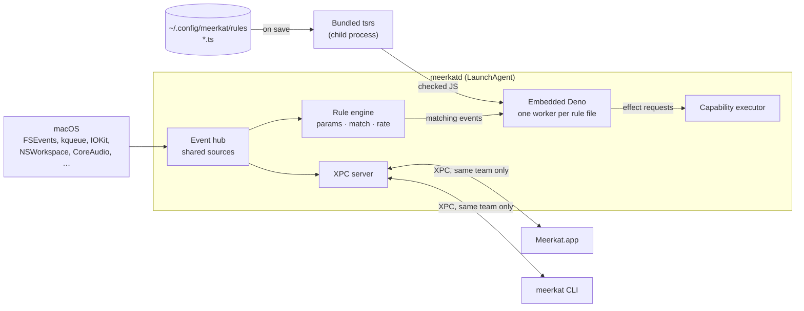
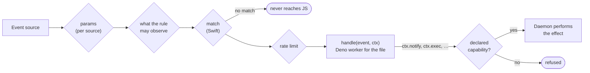

# meerkat

Unprivileged macOS system telemetry and system events, with rules you write
in TypeScript.

meerkat is four things built on one Swift library:

- **`meerkatd`**, a background daemon (a LaunchAgent). It observes events you
  do not control and runs handlers you do: memory pressure, files changing,
  processes starting, disks appearing, the network changing, a microphone
  turning on, the Mac kept awake, the focused window, and more
  (`meerkat events list` prints every kind).
- **Rules**: type-checked TypeScript files in `~/.config/meerkat/rules` that
  see and act only through capabilities they declare.
- **`meerkat`**, a CLI that controls the daemon and takes one-shot
  measurements as JSON or tables.
- **Meerkat.app**, a SwiftUI dashboard in the system's Liquid Glass
  chrome, which is a client of the daemon.

Nothing needs root. A few events need a privacy permission, and only when a
rule subscribes to one.

The measurement side uses fixed methods and explicit cadences, and its numbers
do not perturb what they measure.

Further reading:

- [docs/architecture.md](docs/architecture.md): the map of the whole system:
  processes, trust boundaries, state on disk, and the build and release
  pipeline.
- [docs/design/meerkatd.md](docs/design/meerkatd.md): the daemon's design and
  the evidence behind it. It is the authority for the daemon, the event
  catalog, the rule runtime and the bundle layout.
- [docs/design/effects.md](docs/design/effects.md): the effect catalog:
  what rules can change on the Mac, the grants each effect needs, and
  what is out of scope.
- [docs/design/mcp.md](docs/design/mcp.md): the daemon as an MCP server.
  The read-only resources and tools and `meerkat mcp` are built; the
  rest is open (see its status line).
- [docs/design/rule-editor.md](docs/design/rule-editor.md): the app's rule
  editor and the dry run behind Try It.
- [docs/design/remote-execution.md](docs/design/remote-execution.md): building
  on another Mac, and what Buck2 remote execution would need.
- [docs/design/app.md](docs/design/app.md): the dashboard app: its models,
  feeds, failure handling and presentation rules.
- [docs/development.md](docs/development.md): changing Meerkat: checks,
  style, generated files, tests, releases and CI. [CONTRIBUTING.md](CONTRIBUTING.md)
  and [AGENTS.md](AGENTS.md) are the short versions.
- [Sources/meerkat-lint/README.md](Sources/meerkat-lint/README.md): `meerkat-lint`, the `meerkat/*` lint
  rules.

## Contents

- [Status](#status)
- [Install a release](#install-a-release)
- [Quick start](#quick-start)
- [How it fits together](#how-it-fits-together)
- [Repository layout](#repository-layout)
- [Build and install](#build-and-install)
- [Rules](#rules)
- [CLI](#cli)
- [The app](#the-app)
- [Sampling cost](#sampling-cost)
- [Configuration](#configuration)
- [Storage](#storage)
- [Development](#development)
- [Gotchas worth knowing](#gotchas-worth-knowing)
- [Prior art](#prior-art)
- [License](#license)

## Status

meerkat is in alpha (the version is `[meerkat] version` in
[.buckconfig](.buckconfig)). The daemon, rules, CLI and dashboard work day to
day; the event catalog, the rule API and the stored data may still change
between alpha releases without migration (a store from an earlier schema
is refused, and the error says to move it aside). The app, the CLI and the
daemon ship together and expect to be the same build; after an upgrade,
`meerkat agent install` restarts the daemon from the new bundle.

Known gap in this release: whether `notify` can raise macOS's notification
permission prompt from the daemon is unresolved, so rule notifications may
not appear.

## Install a release

You need macOS 27 or later on Apple silicon. Releases are signed with a
Developer ID and notarized by Apple.

1. Download `Meerkat-<version>.zip` from
   [Releases](https://github.com/gkze/meerkat/releases) and open it.
2. Move `Meerkat.app` to `/Applications` (or `~/Applications`) and open it.
3. Install the agent: the dashboard's **Install Agent** button, or
   `meerkat agent install`. macOS lists it under Login Items.
4. Put the CLI on your `PATH`:

   ```bash
   ln -sf /Applications/Meerkat.app/Contents/MacOS/meerkat ~/.local/bin/meerkat
   ```

5. Write a rule in `~/.config/meerkat/rules` ([Rules](#rules)). macOS asks
   for a privacy permission only when a rule subscribes to an event that
   needs one ([Events that need a permission](#events-that-need-a-permission)).

To upgrade, quit the app, replace `Meerkat.app`, open it once, then run
`meerkat agent install` again: registering again restarts the daemon from
the new bundle ([Managing the agent](#managing-the-agent)). Opening the app
first lets macOS record the new build's signature; without it, launchd can
refuse to run a build signed differently, and `agent install` says so. To
uninstall, run `meerkat agent uninstall`, then move `Meerkat.app` to the
Trash. Your rules and
data stay where [Storage](#storage) lists them; remove those folders too if
you want everything gone.

To build from source instead, see [Build and install](#build-and-install).

## Quick start

With the agent installed, check that the daemon answers and see what it can
observe:

```bash
meerkat status                     # the daemon, its handler host and running sources
meerkat events list                # every event kind, with its parameters and payload
meerkat events watch memory.pressure
```

Then write a rule. Save this as `~/.config/meerkat/rules/downloads.ts`:

```ts
import { rule } from "meerkat";

export const newFiles = rule({
  name: "new-files",
  on: "fs.change",
  params: { paths: ["~/Downloads"] },
  match: { itemType: "file", changes: { includesAny: ["created", "renamed"] } },
  capabilities: { fs: { read: ["~/Downloads"] }, notify: true },
  async handle(event, ctx) {
    await ctx.notify({ title: "New download", body: event.path });
  },
});
```

Watching a folder is reading it, so the rule declares `fs.read` for it as well
as the notifications it posts. The daemon type-checks and loads it on save. `meerkat rules` shows it loaded
(or the compiler's diagnostics if not), and `meerkat rules logs
downloads.ts#new-files` shows what it did. The daemon also writes editor
support next to your rules (`.meerkat/`), so any TypeScript editor
completes events, payloads and capabilities. [Rules](#rules) covers the
rest.

## How it fits together



[docs/architecture.md](docs/architecture.md) has the full map, including
the MCP bridge, the stores and where each trust boundary is enforced.

Every live number, whether it ends up in a rule, the dashboard or
`meerkat events watch`, comes from the same event sources in the daemon.
Subscribers that ask for the same event with the same parameters share one
source, so the machine samples once however many clients and rules there
are.

## Repository layout

Sources/ holds every module, whatever its language. Each directory is named
after what it builds, in that language's convention: Swift and C modules in
PascalCase (the module name), Swift executables in lowercase (the binary
name), Rust crates and the npm package in kebab-case (the package name).

[docs/architecture.md](docs/architecture.md#source-tree) says what each
directory holds.

## Build and install

### Requirements

- macOS 27 and Xcode 27 (Swift 6.4), at the build `[swift] xcode_build` in
  [.buckconfig](.buckconfig) names (`//buck2/rules/swift:xcode_test` checks).
  Buck uses the Xcode at `[swift] developer_dir` for Swift and for clang,
  whatever `xcode-select` says.
- [Buck2](https://buck2.build), which builds everything and fetches every
  third-party dependency at a pinned version and checksum, at the release
  `[buck2_release]` in [.buckconfig](.buckconfig) names
  (`//buck2/rules:buck2_test` checks). Its prelude is bundled, so another
  release could build something else without failing.
- [rustup](https://rustup.rs) on `PATH`, with the Rust release `[rust] release`
  in [.buckconfig](.buckconfig) names and its clippy and rustfmt
  (`rustup toolchain install <release> --component clippy rustfmt`). Buck runs
  that release, whatever rustup's default (`//buck2/rules:rust_test`
  checks), and never installs it.
- Python 3.12 or later as `python3` on `PATH` when Buck's daemon starts: the
  prelude's helpers run on it, and the Rust build scripts' compiler shim
  needs 3.12 (`Path.relative_to(walk_up=)`). macOS's own `python3` is 3.9,
  and with it the build fails in C compiles of `-sys` crates (cc-rs errors
  in lcms2-sys first). `//buck2/rules:python_test` checks; `buck2 kill`
  after changing `PATH`.
- [reindeer](https://github.com/facebookincubator/reindeer) on `PATH`, at the
  commit `[reindeer] rev` names, only for
  `//buck2/third_party/rust/check:buckify_test` and `buck2 run //:fix`, which
  generate `buck2/third_party/rust/BUCK` from the Rust dependencies
  (`cargo install --locked --git https://github.com/facebookincubator/reindeer --rev <rev> reindeer`)
- [Bun](https://bun.sh), only for editors (`Sources/meerkat-rules/node_modules`)
- An Apple Development or Developer ID signing identity in the keychain. The
  daemon accepts only clients signed by the same team, so the daemon of an
  ad-hoc signed bundle (`--identity -`, which CI builds to check the bundle's
  layout) accepts no client.
  Releases need Developer ID ([Releases](docs/development.md#releases)).

### Install

```bash
buck2 run //Tools/Bundler:app -- --install
```

This builds everything the bundle holds in release mode, whatever the mode
on the command line, and checks that the runtime's checked-in bindings match
the library meerkatd links. It then assembles `build/Meerkat.app`: the app, the CLI, the daemon with
the rule runtime embedded, the agent plist, the TypeScript compiler (tsrs), the
lint tools and the app icon. It signs the bundle with hardened runtime,
copies it to `~/Applications/Meerkat.app`, and registers the agent with
`SMAppService`.

Put the CLI on your PATH:

```bash
ln -sf ~/Applications/Meerkat.app/Contents/MacOS/meerkat ~/.local/bin/meerkat
```

- `--identity` (or `MEERKAT_SIGNING_IDENTITY`) picks the signing identity when
  the keychain has more than one.
- Running `buck2 run //Tools/Bundler:app -- --install` again upgrades in place. It opens
  the app in the background, then registers the agent again, which restarts
  the daemon from the new build and applies plist changes.

### Managing the agent

The agent is installed and removed one way, `SMAppService`, whether from the
CLI or from the dashboard's Install button, so either undoes the other:

```bash
meerkat agent install      # or the dashboard's "Install Agent" button
meerkat agent status       # registration state and whether the daemon answers
meerkat agent restart      # restart through launchd, keeping the registration
meerkat agent uninstall
```

`install` and `uninstall` also remove an agent job that another copy of
Meerkat.app registered, such as a deleted build folder. Such a registration
does not show in `status` (it reads `notRegistered`), but launchd keeps
running its job, and once that copy is gone every restart fails with
`EX_CONFIG`.

### Building on another Mac

A cold build takes long enough to be worth doing on another Mac you can
reach over SSH. `//Tools/RemoteBuild:remote` builds a bundle there, then
assembles, signs and (with `--install`) installs it here. Name the host,
and anything it needs first on `PATH` for a non-interactive SSH command, in
`.buckconfig.local` (Git ignores it; Buck reads it after `.buckconfig`):

```ini
[remote_build]
  # The host, as `ssh` names it.
  host = build-mac
  # Optional: directories put first on PATH there; `~/` is the host's home.
  path = ~/.cargo/bin:/opt/homebrew/bin
  # Optional: where the checkout goes there (default: this checkout's path).
  # It must be empty, or a copy this tool made, and an absolute path of
  # letters, digits and / . _ - + @ , (no `~`): the host's shell reads it.
  directory = /Users/me/src/meerkat
```

```bash
buck2 run //Tools/RemoteBuild:remote -- app-debug
buck2 run //Tools/RemoteBuild:remote -- app --install
buck2 run -c remote_build.host=other-mac //Tools/RemoteBuild:remote -- app
```

The first argument is a `//Tools/Bundler` target; the rest go to the
bundler. The tool:

1. Stops unless the host has the same `buck2 --version`.
2. Copies this checkout to the host (`rsync --delete`, without `buck-out`,
   `.build`, `build`, `.buckd`, `.git`, `node_modules` and the host's own
   `.buckconfig.local`). The directory there must be empty or hold the
   `.meerkat-remote-build` file the first copy writes, so a mistyped
   `directory` stops the tool instead of being erased.
3. Runs the toolchain tests there (`//buck2/rules:buck2_test`,
   `//buck2/rules:python_test`, `//buck2/rules:rust_test`,
   `//buck2/rules/swift:xcode_test`), and stops if the host would not build
   what this Mac would: the buck2 release `[buck2_release]` names, the Xcode
   build `[swift] xcode_build` names, rustup with the `[rust] release`, and
   Python 3.12 or later. Those three pins are this Mac's, passed with `-c`
   to these tests and to the build, so a host `.buckconfig.local` that sets
   one cannot pass the tests against its own value.
4. Runs `buck2 run //Tools/Bundler:<target> --command-args-file` there, so
   Buck builds every part and reports the bundler command instead of
   running it.
5. Copies the parts that command names to `build/remote/<target>/<option>/`
   (`--output` for elsewhere), where unchanged parts are not sent again.
6. Runs the bundler here, from the repository root, with those paths and
   this Mac's `[swift] developer_dir`.

Signing needs this Mac's identity, so it never happens on the host, and the
host needs no keychain: only SSH access and the build requirements above
(the Xcode, rustup with the `[rust] release`, the same buck2 and Python
3.12 or later). Keeping the default `directory`, the same path on both
Macs, keeps the paths in debug info valid here. The parts link only system
libraries, so they run here.
[docs/design/remote-execution.md](docs/design/remote-execution.md)
compares this with Buck2 remote execution.

### Previewing app changes

To check app changes without replacing the installed app or its agent, build
a preview:

```bash
buck2 run //Tools/Bundler:preview
open "build/Meerkat Preview.app"
```

The preview contains only the app, with the same Info.plist and icon, under
its own bundle identifier (`com.gkze.meerkat.preview`), so it keeps its own
defaults. It has no daemon, CLI or LaunchAgent plist: it talks to the
installed daemon and cannot install or replace the agent. It is a debug
build (so `MEERKAT_SAMPLE_DATA=1` works), does not build the runtime, and
cannot be installed. `//Tools/Bundler:app-debug` is the full bundle from a
debug build.

## Rules

A rule names an event, narrows it, declares what it may see and do, and
handles it, as the [Quick start](#quick-start)'s `downloads.ts` does.

More examples, all compiled by the test suite, are in
[Sources/meerkat-rules/examples](Sources/meerkat-rules/examples). Every event's payload, parameters and delivery
guarantees are listed by `meerkat events list` and in the generated
[Sources/meerkat-rules/meerkat.d.ts](Sources/meerkat-rules/meerkat.d.ts).

### From event to effect



`params` configure the source and `match` filters payload fields. Both are
typed per event and evaluated in Swift, so events that do not match never
reach JavaScript. Handlers react after the fact: nothing an unprivileged
process can observe lets it block the event.

### Files, exports and ids

- `rule()` returns the rule. A top-level file runs the rules it exports,
  either as exports of their own or in an exported array (nested arrays are
  flattened); other exports are ignored. The default export counts too, so
  a whole file can be `export default [rule({ ... }), rule({ ... })]`.
- Keep every rule in one file (`index.ts` can `export * from "./lib/audio"`)
  or spread them over many, each with any number of exports.
- A rule's id is `<file>#<name>`, where the file is the top-level file that
  exports it.
- A file that creates rules but exports none fails to load, and unexported
  rules are logged as warnings. `export * as audio` exports an object, not
  rules, so those rules do not run.

### Type checking, editors and linting

- Saving a file reloads the rules in well under a second. The daemon
  type-checks the whole directory with tsrs, the Rust port of TypeScript 7's
  compiler. A file
  with a type error is not run; every other file keeps running.
- The daemon writes `.meerkat/meerkat.d.ts`, `.meerkat/deno.d.ts` (the
  runtime's globals) and a `tsconfig.json` into the rules directory. Editors
  then check rules against the running daemon's catalog and runtime, with the
  daemon's compiler options; `tsrs --lsp --stdio` is the matching language
  server. `meerkat rules check [dir]` does the same from the command line.
- Rules are linted and format-checked with this repository's policy, by tools
  Meerkat.app ships, so no Node or Bun is needed: Oxlint with type-aware rules
  on tsrslint, meerkat-lint for the `meerkat/*` rules, and Oxfmt.
- The daemon writes `.meerkat/oxlintrc.json` (the policy, kept current) and,
  when they are absent, `.oxlintrc.json` and `.oxfmtrc.json`, which are yours
  after that. Editors with the Oxc extension pick them up.
- Each reload lints in the background. `meerkat rules` lists the findings,
  which are advice and never stop a rule from loading.
  `meerkat rules lint [--fix] [dir]` lints or fixes
  and formats; `meerkat rules fmt [--check] [dir]` formats.
- `meerkat rules dry-run <file> [--sample seconds | --payload json]` runs a
  rule from a file on events with its effects captured: nothing is sent,
  written or run, and the report shows what the handler asked for.

### Isolation and limits

- Handlers run in Deno, embedded in the daemon. Each file runs in a worker of
  its own (its own thread, V8 isolate, heap limit and Deno permissions), and
  each invocation has a deadline.
- A handler stuck in a loop is interrupted and the host restarts. So is a
  file whose timers keep its thread busy, or whose code runs out of heap. A
  file whose top-level code hangs is rejected on its own. Editing one file
  leaves the other files' rules running.
- A rule that keeps failing, or runs more than 120 times a minute, is
  disabled until its file changes. A rule whose handler holds the thread
  past its deadline, ending the host, three times within five minutes is
  disabled the same way. When the file's own code ends it (a timer, or
  running out of the heap all its rules share), the file is left out until
  it changes.
- Whatever a rule's file grants say, its code cannot change the rules
  folder, `meerkat.json` (where its symlink leads, too), the daemon's state
  or the app: not through a symlink, a hard link, or by renaming a folder or
  link above them. Nor can it read the daemon's state. The APIs that write or
  watch files around those checks are off: `node:fs`'s `cp` (it clones whole
  trees), Deno KV, `node:sqlite` databases, `node:wasi`, Unix socket
  listeners and file watching (`Deno.watchFs`, `fs.watch`; use the
  `fs.change` event). So are Web Locks, which every file would share.
- The heap limit does not cover memory outside the JavaScript heap, such as
  `ArrayBuffer` contents, and a handler may use the CPU for its whole
  timeout each time it runs.

### Capabilities

A rule sees only what it declares, as it acts only through what it declares.
Rules run inside the daemon as you, so macOS's file permissions narrow
nothing: the rule's grants are the boundary.

Observing an event can need a grant. `meerkat events list` says which, and
the types make `capabilities` required where one is; a rule without it does
not load, and the message names the grant to add:

| Events | Grant |
| --- | --- |
| Ambient state about this Mac: memory, CPU, power, displays, volumes, devices, the network's state, time, … | none |
| `fs.change`, `fs.churn` | `fs: { read: [...] }` covering every watched path; nothing at, inside or above the daemon's state folder |
| `process.*`, `app.*` | `process: { observe: "own" }` for your own processes, `"all"` for every user's |
| `window.focused`, `input.activity`, `pasteboard.changed`, `camera.inUse`, `audio.inUse`, `network.wifi`, `bluetooth.devices`, `session.logins`, `log.entry`, `darwin.notification`, `distributed.notification`, `iokit.*`, `power.assertions` | `observe: { allow: ["window.focused", ...] }`, naming each |

With `"own"`, events about other users' processes never reach the rule, and
their rows are left out of `process.top` and `process.list`. `fs.churn` without a `root`
measures `meerkat.json`'s `files` scope: if an edit moves it outside the
grant, the rule fails and says why, and resumes when it fits again. A
`meerkat.rule` status, a `meerkat.dropped` report and a `meerkat.notification`
response reach a rule only when they are about its own file.

Effects go through capabilities the rule declares and the daemon enforces.
They work only while the rule's handler is running.

Grants cover notifications, your own processes (targeted by pid plus start
time), allow-listed executables with no shell, requests to allow-listed
origins, the sample store, file reads and writes, keeping the Mac awake, audio,
applications, URLs, volumes, the Trash and Finder tags, user defaults,
Shortcuts, Wi-Fi power, the clipboard, windows and the appearance.
`meerkat effects` lists every effect and its grant, and
[docs/design/effects.md](docs/design/effects.md) explains them.

`ctx.state` (persistent JSON: at most 1024 keys and 8 MiB per rule, 1 MiB per
value; null is a value, which `set` stores) and `ctx.log` are always available.

A click on a notification, one of its actions, or closing it arrives as a
`meerkat.notification` event. Only rules in the file whose rule posted the
notification receive it; the app, the CLI and MCP cannot subscribe to it.
[Sources/meerkat-rules/examples/heavy-writers.ts](Sources/meerkat-rules/examples/heavy-writers.ts)
uses this for an "undo" button.

### Events that need a permission

A few events need a privacy permission:

| Event                                  | Permission       |
| -------------------------------------- | ---------------- |
| `window.focused`                       | Accessibility    |
| `input.activity`                       | Input Monitoring |
| `bluetooth.devices`                    | Bluetooth        |
| `network.wifi` (the network name only) | Location         |

Each also needs its observation grant: the permission is the daemon's, the
grant is the rule's. Nothing is requested until a rule subscribes to one of these. The
subscription then fails and names the Settings pane where Meerkat can be
enabled; after granting it, run `meerkat rules reload`. The grant belongs to
the signed app bundle, so it survives rebuilds signed by the same team.
`meerkat events list` marks these events.

Some effects need a macOS permission too. `windows.list` and `windows.set`
need Accessibility, `meerkat effects` marks them, and they fail with the
Settings pane to use. macOS may ask before the first `clipboard.read`.
`appearance.setDark` needs Automation for System Events, which only the app
can ask for: use the Automation section of Meerkat's Settings.

## CLI

### Daemon and rules

```bash
meerkat status                   # daemon, handler host, running sources
meerkat rules                    # loaded and failed rules, diagnostics
meerkat rules reload
meerkat rules logs downloads.ts#new-files
meerkat rules disable downloads.ts#new-files
meerkat rules enable downloads.ts#new-files
meerkat rules check ~/drafts     # type-check a folder; no daemon needed
meerkat rules lint ~/drafts      # lint a folder; writes nothing without --fix
meerkat events list
meerkat events watch memory.pressure
meerkat events watch fs.change --params '{"paths":["~/Documents"]}' --count 5
meerkat effects                  # every effect, its grant and permission; the observation grants
meerkat types --output my.d.ts   # the declarations for this build
meerkat mcp                      # MCP on stdin and stdout, for MCP clients
meerkat skills                   # instructions for coding agents
```

### MCP

`meerkat mcp` is an MCP stdio server for coding agents and chat clients.
Configure the client with the `meerkat` inside Meerkat.app (meerkatd accepts
only clients signed with the app). Claude Code:

```bash
claude mcp add -s user meerkat -- ~/Applications/Meerkat.app/Contents/MacOS/meerkat mcp
```

Codex, in `~/.codex/config.toml`:

```toml
[mcp_servers.meerkat]
command = "~/Applications/Meerkat.app/Contents/MacOS/meerkat"
args = ["mcp"]
```

Any other client that starts a stdio server:

```json
{ "command": "~/Applications/Meerkat.app/Contents/MacOS/meerkat", "args": ["mcp"] }
```

Clients that don't expand `~` need the full path.

- **No socket.** The bridge relays bytes over the daemon's XPC service, and
  the MCP server runs inside meerkatd, one session per bridge.
- **Read-only.** The resources are `meerkat://status`, `meerkat://catalog`
  (and `meerkat://catalog/{kind}` with JSON Schemas), `meerkat://types`,
  `meerkat://config`, `meerkat://rules` with each rule's log, and
  `meerkat://samples` (and `meerkat://samples/{label}`). The
  `resource_read` tool reads the same, for clients that call tools but
  don't read resources.
- **Six tools.** `events_sample` watches one event kind for at most 30
  seconds or 500 events. `system_sample` measures one window, as
  `meerkat sample` does, while the policy allows `process.top`, `cpu.sample`
  and `memory.sample`, whose data it carries; it leaves out the host name,
  which none of them carries. `samples_compare` compares two labels of the
  sample store, as `meerkat compare` does, over each label's newest `limit`
  samples (default 100). `rules_check`
  type-checks text without running it, and reads no file outside the rules
  folder. `rules_dry_run` runs a rule already saved in the rules folder on its
  event's examples, with its effects captured and stored state left out. No
  client can run code of its own, or write a rule. Replies are JSON, and
  structured content when they are objects; `resource_read` of
  `meerkat://types` is the TypeScript, as text.
- **Prompts.** The [agent skills](#agent-skills) are also MCP prompts.
- **Sensitive event kinds are off by default.** Kinds that need a privacy
  permission are not offered, and neither are the kinds that carry arbitrary
  text from other programs (`log.entry`, `darwin.notification`,
  `distributed.notification`, `iokit.*`, `power.assertions`). `meerkat.json` can allow or deny
  kinds and change the limits, live ([Configuration](#configuration)). An
  allowed permission kind still needs its grant: MCP never prompts for one.
- **Bounded replies.** A resource read or tool reply over `outputKiB`
  is cut to it and marked `truncated`; a rule's log keeps its newest entries
  instead, and `events_sample` stops adding events once theirs would pass it.
- **Restarts.** When meerkatd restarts, the bridge exits with status 69, and
  the client starts it again. A line from the client longer than 4 MiB ends
  the session with status 1: a new bridge would refuse it too.

The design and the remaining steps are in
[docs/design/mcp.md](docs/design/mcp.md).

### Agent skills

Meerkat ships instructions for coding agents, and hands them out two ways: as
skills, and as MCP prompts with the same text. `meerkat-diagnose` finds out
what a Mac is doing, and `meerkat-rules` writes, checks and tries a rule.

```bash
meerkat skills                            # what this build has
meerkat skills show meerkat-rules         # print one SKILL.md
meerkat skills install --to ~/.claude/skills
```

Use the folder your agent reads skills from, and run `install` again after
upgrading. It won't replace a skill you've edited without `--force`. There is
no plugin package: one would copy the skills' text, and `skills install`
already writes this build's.

Commands an agent acts on keep to one contract, which `meerkat --help` states:
`--json` wherever there's data, and exit statuses that mean what they say.
`CLITests` holds every command to having `--json` or a stated reason not to,
and runs the built `meerkat` to check each status, stream and error object
below for the failures that need no daemon. A failed check (rules, lint, format,
`config check`, `agent status`) exits 1 with or without `--json`, and its
findings are its output. A file or folder that doesn't exist is 66, a daemon or
tool the app ships that isn't there is 69, a usage error is 64, and an
`agent install` whose daemon didn't answer yet is 75. With
`--json`, any other failure, a usage error included, writes one object to
stderr, `{"error": {"status": 69, "message": "..."}}`, after any notes in
text; so does a usage error of a command that always prints JSON (`events
watch`, `config show`, `config schema`). A command that names no operation,
like a bare `meerkat`, prints its help to stdout and exits 0.

### Measurement

```bash
meerkat sample --window 5 --top 8 --churn ~/Library --table
meerkat sample --window 10 --pretty # JSON to stdout
meerkat sample --window 10 --system-only --table
meerkat --help                      # also: help sample|analyze|compare
```

Arguments are parsed with
[swift-argument-parser](https://github.com/apple/swift-argument-parser), so
values are type-checked: a malformed or non-positive `--window`, `--top`,
`--repeat`, `--retain` and so on is rejected (exit 64) rather than silently
replaced with a default.

One sample measures one window: process CPU and disk, machine-wide CPU and,
with `--churn`, file changes all cover the same `--window` seconds, and
memory and load are read at its end. A process writing in the rows is in
that sample's churn. Stores written by builds that measured churn in a
window of its own, before the processes, can't be read for that pairing.

Each process row carries:

- `name`: short, for display
- `path`: the executable from `proc_pidpath`; omitted when unknown
- `startedAt`: Unix epoch milliseconds; together with `pid` it identifies the
  process instance
- `uid`

`--system-only` keeps the rows whose executable ships with macOS, whichever
user the process runs as:

- **Kept:** `/System/`, `/usr/`, `/bin/`, `/sbin/` and `/Library/Apple/`,
  plus cryptexes (`/System/Volumes/Preboot/Cryptexes/<name>/…` and
  `/System/Cryptexes/<name>/…`). Cryptexes are judged by the path inside the
  cryptex, so WebKit's XPC services count and Safari does not.
- **Dropped:** Apple's apps in `/System/Applications/`, `/usr/local/`, every
  other `/Library/` path (third-party daemons, agents and system extensions,
  and Xcode's `/Library/Developer/`), and any other `/System/Volumes/` path.

This is a path rule; code signatures are not read. A row with no known path
is excluded.

### Before/after measurements

```bash
BIN=meerkat
DB=~/Library/Application\ Support/com.gkze.meerkat/samples.db

# 1. Baseline: 10 samples, long windows, labelled and written to the store
$BIN sample --repeat 10 --label baseline --window 30 --db $DB

# 2. Make exactly one change

# 3. After: identical flags, different label
$BIN sample --repeat 10 --label after --window 30 --db $DB

# 4. Compare medians, ranges and deltas
$BIN compare $DB
```

`compare` prints per-label medians with the observed min–max, the delta
between two labels, and two warnings (`--json` gives the same as data, and
MCP's `samples_compare` the same for two labels, over each label's newest
100 samples unless it is given another `limit`):

- **Overlapping ranges:** the distributions are not separable at this n, so
  there is no result yet.
- **High within-label variance:** that metric's own spread is comparable to
  the effect, so a delta is not evidence.

Measured here with 3 samples per label and _no change made_:

| Metric          | Label A           | Label B             | Reading                            |
| --------------- | ----------------- | ------------------- | ---------------------------------- |
| `churn_events`  | 37 [24–60]        | 115 [110–189]       | 211% "change" with nothing changed |
| `compressed_mb` | 9885 [9873–10080] | 10325 [10210–10375] | 4% drift, measurable               |
| `swap_mb`       | 3500 [3500–3500]  | 3500 [3500–3500]    | pinned, unchanged                  |

So n=3 is not enough on a loaded host. Use at least 10 samples with 30 s
windows, and treat a single churn window as noise: it is dominated by
whichever apps happen to be writing.

## The app

```bash
open ~/Applications/Meerkat.app
```

The dashboard is a client of `meerkatd`. Its pages:

- **Overview:** CPU, memory, disk, network, power and path churn, with the
  busiest processes. Each card opens its resource's page.
- **CPU, Memory, Disk, Network, Power and Files:** one page per resource,
  with its live chart, a breakdown and the processes or folders behind it.
  The CPU, Memory, Disk and Power (energy) tables list every process the
  page can measure, largest first, and sort by any column. Other users'
  processes report CPU only, so only the CPU table has them.
  They are also in the sidebar, with each one's live value.
- **Process card:** double-click a process on the CPU, Memory, Disk or Power page
  (or choose Show Details) for its card. It follows that one process with
  `process.sample` while open, so it keeps updating after the process
  leaves the ranking. It also shows what it keeps awake, the helpers it
  runs and the rules on process events. From the card you can show it in
  Finder, quit or force quit it (the pid is checked against its start time
  first; quitting a process that isn't an app asks first, as force quitting
  does), or make a rule. **Make a Rule…** writes a `process.hot` rule for
  that process into the rules folder as a TypeScript file you can edit;
  it never replaces an existing file.
- **Rules:** what loaded, what failed and why, what each rule has done, and
  switches to turn rules off and on. **Edit Rules** opens the rule files in
  an editor on the page, with tsrs's type errors as you type; saving
  reloads them like a save from any editor, and **Try It** runs the unsaved
  text on events with every effect captured
  ([docs/design/rule-editor.md](docs/design/rule-editor.md)).
- **Event Explorer:** every event kind the daemon offers, and a live view of
  any one of them.
- **Daemon Health:** the daemon process, the rule runtime, and every running event
  source with its subscribers, throughput and drops.

When the daemon does not answer, the dashboard says why and offers the fix:
install the agent, switch it on in Login Items, restart it when it is a
different build from the app, or reinstall it when it is registered but
silent. Restart and Reinstall ask first, wherever they are offered, since
rules miss events while the daemon restarts. When the daemon answers but one
of its sources fails (a folder `fs.churn` watches goes away, the battery
can't be read), only that card and page say so, and that feed tries again on
its own.

Buck builds the app executable, but it shows a window only from inside the
bundle, which is why `//Tools/Bundler:preview` exists. There is no Xcode
project to keep in step with the BUCK files.

## Sampling cost

Truly "realtime without sampling" is not possible for CPU: `proc_pid_rusage`
returns cumulative counters, so any consumer must read them at some interval.
What can be avoided is putting the _expensive_ read on the hot path. The
Overview's subscriptions therefore run on two clocks, a cheap fast one and
an expensive slow one. With the Normal sampling preset (Settings also offers
Relaxed, Live and Custom):

| Event                                                                    | Interval           | What it reads                                                  | Cost                          |
| ------------------------------------------------------------------------ | ------------------ | -------------------------------------------------------------- | ----------------------------- |
| `cpu.sample`                                                             | 1 s (Live: 0.25 s) | machine CPU from `host_statistics` tick deltas (one mach call) | negligible                    |
| `memory.sample`, `disk.sample`, `network.sample`                         | 1 s                | one chart point each                                           | small                         |
| `battery.sample`                                                         | 5 s, fixed         | the battery controller's readings                              | small                         |
| `process.top`                                                            | rows every 1 s     | re-reads only the ~5 processes displayed (`ps` for other users') | small                         |
| `process.top`                                                            | ranking every 5 s  | full enumeration to rank who is busy                           | the expensive one, kept rare  |
| `process.list`                                                           | every 5 s          | the same enumeration, every row, for the resource pages        | shares the ranking's snapshot |
| `fs.churn`                                                               | 4 s of every 25 s  | FSEvents over the startup volume (`meerkat.json` `files`)      | push-driven within the window |
| `memory.pressure`, `thermal.state`, `power.lowPowerMode`, `power.source` | push               | the header chips                                               | free                          |

- **Occlusion gate.** When the window is hidden or covered, the dashboard
  cancels its subscriptions, and the daemon stops every source nobody else
  uses.
- **Separate scalar and series.** The headline CPU number can update at
  4 Hz (the Live preset) while the chart series update at 1 Hz, because rebuilding Swift Charts
  paths four times a second cost more than the sampling itself.
- **Shared sources need equal parameters.** The daemon shares a source only
  between subscribers with the same parameters, so rates that differ from a
  rule's run their own sampler alongside it.

Sampling cost sits in the daemon. One 60 s measurement on a 14-core M4
Max under heavy unrelated load (load average ~85), from `ps` CPU time, taken
when the dashboard had five subscriptions (`cpu.sample`, `memory.sample`,
`memory.pressure`, `process.top`, `fs.churn`):

| State                              | `meerkatd` CPU                           | Resident |
| ---------------------------------- | ---------------------------------------- | -------- |
| No clients, no rules               | 0 s in 30 s (below the 10 ms resolution) | 15 MB    |
| The dashboard's five subscriptions | 0.45 s in 60 s, ~0.75% of one core       | 21 MB    |

That is one run on a loaded machine: an order of magnitude, not a benchmark.
It has not been repeated with the Overview's current subscriptions. The app's
own rendering cost (measured before the daemon existed: ~17% of one core
while visible and compositing) is unchanged by this design and was not
re-measured.

## Configuration

What the daemon does is fixed when it is built; how far it may go is set
while it runs. Three tiers, from most to least dynamic:

| Tier                                            | Applies                                     | What                                                                                                             |
| ----------------------------------------------- | ------------------------------------------- | ---------------------------------------------------------------------------------------------------------------- |
| Rules and `meerkat.json` in the rules directory | on save, within a second                    | rules and everything they declare; the MCP policy and limits; the sample store's budget; what file churn watches |
| The `com.gkze.meerkat` defaults domain          | at `meerkat agent restart`                  | where the daemon keeps things ([Storage](#storage))                                                              |
| The build                                       | after a rebuild and `meerkat agent install` | event sources, effects, the MCP surface, the LaunchAgent plist                                                   |

`meerkat.json` is data, never code, checked against a JSON Schema that is
generated from the daemon's own declaration of it
(`MeerkatConfiguration.schema`):
[Sources/meerkat-rules/meerkat.schema.json](Sources/meerkat-rules/meerkat.schema.json),
and `.meerkat/meerkat.schema.json` in the rules directory, which the daemon
keeps current. Every field is optional; an absent one keeps its default.
[Sources/meerkat-rules/examples/meerkat.json](Sources/meerkat-rules/examples/meerkat.json)
sets them all:

```json
{
  "$schema": "./.meerkat/meerkat.schema.json",
  "mcp": {
    "events": { "allow": ["log.entry"], "deny": ["fs.change"] },
    "limits": {
      "sampleSeconds": 60,
      "sampleEvents": 1000,
      "outputKiB": 2048,
      "concurrentSamples": 2
    }
  },
  "samples": { "maxAgeDays": 90, "maxMegabytes": 2000 },
  "files": { "root": "~", "exclude": ["~/Library/Caches", "~/Library/Biome"] }
}
```

- **A broken edit changes nothing.** A file that fails validation leaves the
  last version that applied in force (the defaults, if none has), and its
  problem shows in `meerkat status`, `meerkat rules` and the app's Rules
  page. It never waits on the rules' compile, so a rule's type error cannot
  hold it back.
- **What file churn watches.** `files` sets the folder the Files card and
  page measure, and every `fs.churn` subscription that names no `root`. By
  default it is the whole startup volume, less the system's own bookkeeping
  (`/private/var/folders`, `/private/var/db`, the Spotlight and FSEvents
  stores). `exclude` replaces that list. Paths take `~` and are matched the
  way FSEvents reports them, so `/var/folders` means `/private/var/folders`.
  A change applies at the next measurement window, without resubscribing.
- **Rules cannot change it.** Rule code cannot write the rules directory or
  the defaults domain, so no rule can widen the policy it runs under.
- **Commands:** `meerkat config show` prints what applies, with every default
  filled in; `meerkat config check [file]` validates a file without the
  daemon; `meerkat config schema` prints the schema. MCP clients read it as
  `meerkat://config`.

## Storage

| Path                                                        | Defaults key     | Environment         | Contents                                   |
| ----------------------------------------------------------- | ---------------- | ------------------- | ------------------------------------------ |
| `~/.config/meerkat/rules/`                                  | `RulesDirectory` | `MEERKAT_RULES_DIR` | your rules and `meerkat.json`              |
| `~/Library/Application Support/com.gkze.meerkat/samples.db` | `SampleDatabase` | `MEERKAT_DB`        | samples from the `store.record` capability |
| `~/Library/Application Support/com.gkze.meerkat/rules.db`   | `RuleDatabase`   | `MEERKAT_RULE_DB`   | per-rule state and rule logs               |
| `~/Library/Caches/com.gkze.meerkat/`                        | `CacheDirectory` | `MEERKAT_CACHE_DIR` | the rules as tsrs compiled them            |

To move one, set its key in the `com.gkze.meerkat` defaults domain and
restart the daemon; the CLI reads the same keys, and the app follows the
daemon's rules folder:

```bash
defaults write com.gkze.meerkat RulesDirectory ~/Development/my-rules
```

The environment variable, when set, wins over the key. The installed agent's
plist sets none, so they are for tests and development runs.

`meerkat sample --db`, `meerkat compare` and `meerkat analyze` take a
store's path explicitly; pass this one to work with what rules recorded.

The sample store keeps what was measured, once, as integers in the
sampler's units (bytes, microseconds, nanojoules); percentages and MB are
computed when read.

- `samples`: one row per sample: when, label, the measured window,
  machine-wide CPU usage, load and memory. The host is a row in `hosts`.
- `process_samples`: the top-N processes in that window. Each refers to a
  row in `processes` (pid plus start time, so one row follows one process
  across samples), which refers to `executables` (name and path, stored
  once).
- Footprint, disk and energy are NULL for other users' processes, whose
  counters macOS does not give an unprivileged reader. NULL means unknown;
  zero means none.
- `churn`, `churn_paths` and `churn_categories`: FSEvents activity, for
  samples that measured it, with paths stored once in `paths`.

A sample with 20 processes takes about 0.7 KB, plus lookup rows the first
time a process or path appears.

The store bounds itself after every insert: samples more than 30 days older
than the newest one are deleted, and past 500 MB of pages in use the oldest
samples go until it is back under 450 MB. `meerkat.json`'s `samples`
section changes both, live, for any store `meerkat sample --db` writes as
well; while that file is invalid, `--db` refuses to write rather than apply
the defaults. A rule's or the CLI's `retain` keeps the newest N
samples under that writer's own label, within that budget; other labels are
untouched. At one 20-process sample a
minute (about 1 MB a day), the 30 days come to about 30 MB, so the size
limit applies only to much denser recording.

It uses WAL mode, a GRDB `DatabaseMigrator`, and cascade deletes that keep
child rows in step; deleting samples also removes processes, executables
and paths that no remaining sample uses. Queries are built with
[SQLiteData](https://github.com/pointfreeco/sqlite-data)'s `@Table` types and
checked against the migrated schema by a test. Before 1.0 the schema can
change without a migration: opening a store compares its tables, indexes
and triggers with the ones this build creates, so a file written by a
different schema, or one that is not a store at all, is refused unchanged
rather than misread, and the error says to move it aside. `compare`,
`analyze` and MCP open the store read-only and never create or change it.
`meerkat sample --db` keeps sampling when a write fails, and exits 1 after
the run if any did. A store that doesn't exist is exit status 66.

To record a sample on a schedule, use a rule:
[Sources/meerkat-rules/examples/recorder.ts](Sources/meerkat-rules/examples/recorder.ts) records one
every five minutes. Copy it into the rules directory to use it.

## Development

Checks, style, the shipped lint tooling, generated declarations, what the
tests cover, releases and the CI runner are in
[docs/development.md](docs/development.md); [AGENTS.md](AGENTS.md) is the
short version for coding agents.

## Gotchas worth knowing

- **mach timebase.** `ri_user_time` and friends come back in mach
  absolute-time ticks, not nanoseconds. On Apple Silicon a tick is
  41.666667 ns, so dividing by 1e9 undercounts every CPU number by 41×.
  `MachTime` handles it and a test guards the assumption.
- **EPERM for other users.** `proc_pid_rusage` fails for processes you do not
  own (WindowServer, for example). Those rows come from `ps` instead: CPU time
  at 10 ms resolution, with footprint, disk and energy reported as 0 because
  `ps` cannot supply them. `proc_name` fails for them too, so their name is
  taken from the executable path, which `proc_pidpath` returns unprivileged.
- **TCC silences FSEvents.** Protected paths emit no events rather than
  errors.
- **Disk I/O is a cumulative counter**, so it is meaningful only as a delta
  between two snapshots.
- **Pids are reused.** Deltas, the name cache and every process effect use
  pid plus start time (`kinfo_proc`), so a reused pid is never mistaken for
  the process that had it before.
- **Main run loop.** NSWorkspace, distributed-notification and CoreGraphics
  callbacks are delivered only while the main thread runs `CFRunLoopRun()`.
- **Bluetooth without a usage string kills the process.** macOS terminates a
  process that touches Bluetooth without `NSBluetoothAlwaysUsageDescription`
  in its Info.plist. `bluetooth.devices` checks for the key before using
  IOBluetooth, and refuses to start under a test runner.
- **Interface counters from `getifaddrs` are 32-bit** and wrap every 4 GB, so
  `network.sample` reads the 64-bit `if_data64` from `NET_RT_IFLIST2`.

## Prior art

- `powermetrics --show-process-io / --show-process-energy` (root),
  `fs_usage`, `iosnoop`, `xctrace`
- [macmon](https://github.com/vladkens/macmon) (no sudo, IOReport),
  [asitop](https://github.com/tlkh/asitop),
  [Stats](https://github.com/exelban/stats)
- [watchman](https://github.com/facebook/watchman) (FSEvents)
- [osquery](https://osquery.readthedocs.io/en/stable/deployment/process-auditing/)
  (EndpointSecurity)

meerkat does not replace these. It fills the gap where unprivileged
per-process counters, push-driven path churn, and a labelled local history
need to live in one place, and where you want to react to system events with
code of your own.

## License

MIT; see [LICENSE](LICENSE).

### Third-party code

Meerkat.app also contains third-party code under its own licenses: V8 and
Deno, the Rust crates and Swift packages it links, the tree-sitter grammars,
tsrs, tsrslint, Oxlint and Oxfmt, and the crates those four programs are
built from. `THIRD_PARTY_NOTICES` lists each one with its version, license
and license text. In the app it is `Contents/Resources/THIRD_PARTY_NOTICES`,
the About panel points to it, and each GitHub release attaches a copy.

The file is generated from what the bundle's parts depend on, so it covers
what ships and not build-time or test-only code; the prebuilt programs'
crates are those their release's Cargo.lock locks. Its header says how the
texts are chosen. Building it fails when a component's license is not one
[deny.toml](buck2/third_party/rust/check/deny.toml)'s `[licenses] allow`
lists, unless `EXCEPTIONS` in [Tools/Notices/BUCK](Tools/Notices/BUCK)
records why it ships anyway. Two do today: CodeEditLanguages and
CodeEditSymbols publish no license and ship as they are, by decision
([rule-editor.md](docs/design/rule-editor.md#licences)). To read the file without building a bundle:

```sh
buck2 build //Tools/Notices:notices --show-output
```
