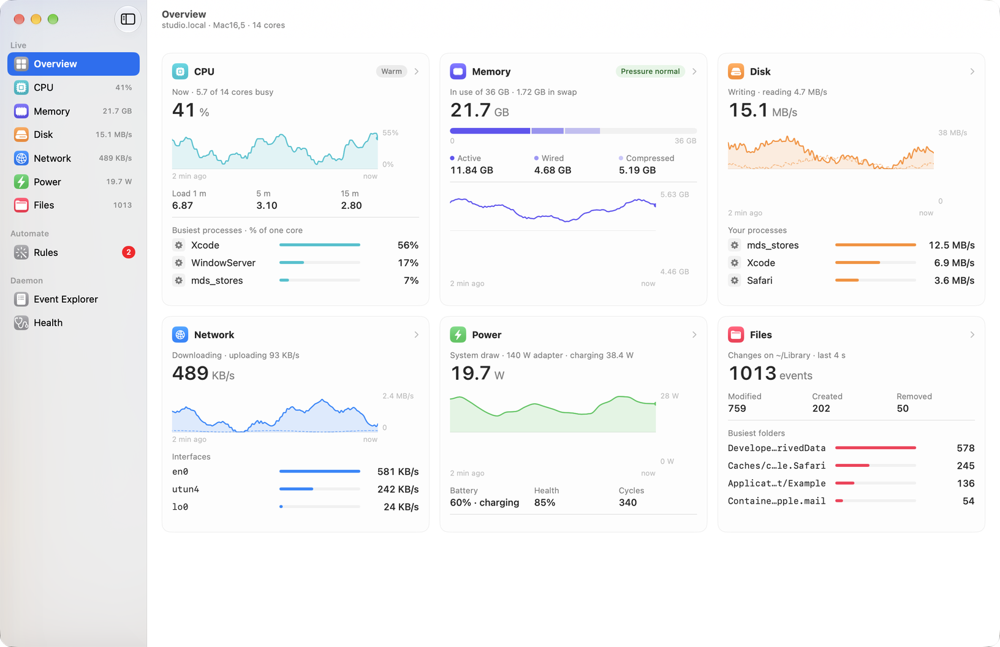
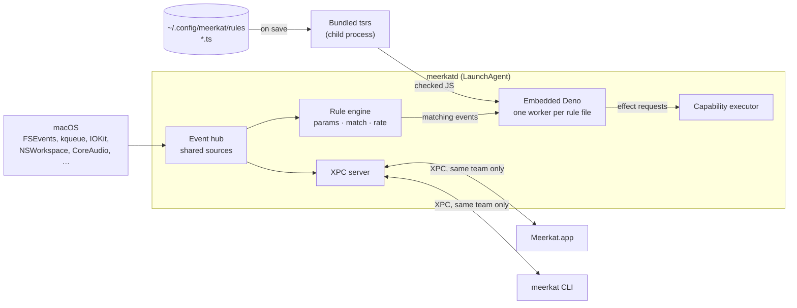

<p align="center">
  
</p>

<h1 align="center">Meerkat</h1>

<p align="center">
  Unprivileged macOS system telemetry and system events, with rules you write in TypeScript.
</p>

<p align="center">
  <a href="https://github.com/gkze/meerkat/releases"></a>
  <a href="LICENSE"></a>
  
</p>

<picture>
  <source media="(prefers-color-scheme: dark)" srcset="docs/images/overview-dark.png">
  
</picture>

Meerkat is four things built on one Swift library:

- **`meerkatd`**, a background daemon (a LaunchAgent). It observes events you
  do not control and runs handlers you do: memory pressure, files changing,
  processes starting, disks appearing, the network changing, a microphone
  turning on, the Mac kept awake, the focused window, and more
  (`meerkat events list` prints every kind).
- **Rules**: type-checked TypeScript files in `~/.config/meerkat/rules` that
  see and act only through capabilities they declare.
- **`meerkat`**, a CLI that controls the daemon and takes one-shot
  measurements as JSON or tables, with a read-only MCP server and skills for
  coding agents.
- **Meerkat.app**, a SwiftUI dashboard, which is a client of the daemon.

Nothing needs root. A few events need a privacy permission, and only when a
rule subscribes to one. The measurement side uses fixed methods and explicit
cadences, and its numbers do not perturb what they measure.

## Status

meerkat is in alpha (the version is `[meerkat] version` in
[.buckconfig](.buckconfig)). The daemon, rules, CLI and dashboard work day to
day; the event catalog, the rule API and the stored data may still change
between alpha releases without migration (a store from an earlier schema
is refused, and the error says to move it aside). The app, the CLI and the
daemon ship together and expect to be the same build; after an upgrade,
`meerkat agent install` restarts the daemon from the new bundle.

Rule notifications come from Meerkat, under its own entry in System Settings ›
Notifications. If macOS has it turned off, `notify` fails and says so; turn
on Meerkat there.

## Install

You need macOS 27 or later on Apple silicon. Releases are signed with a
Developer ID and notarized by Apple.

1. Download `Meerkat-<version>.zip` from
   [Releases](https://github.com/gkze/meerkat/releases) and open it.
2. Move `Meerkat.app` to `/Applications` (or `~/Applications`) and open it.
3. Put the CLI on your `PATH`; the command below assumes `/Applications`, so
   use `~/Applications` there if you moved the app:

   ```bash
   ln -sf /Applications/Meerkat.app/Contents/MacOS/meerkat ~/.local/bin/meerkat
   ```

4. Install the agent: the dashboard's **Install Agent** button, or
   `meerkat agent install`. macOS lists it under Login Items.
5. Write a rule in `~/.config/meerkat/rules` ([Rules](docs/rules.md)). macOS asks
   for a privacy permission only when a rule subscribes to an event that
   needs one ([Events that need a permission](docs/rules.md#events-that-need-a-permission)).

To upgrade, quit the app, replace `Meerkat.app`, open it once, then run
`meerkat agent install` again: registering again restarts the daemon from
the new bundle ([Managing the agent](docs/cli.md#managing-the-agent)). Opening the app
first lets macOS record the new build's signature; without it, launchd can
refuse to run a build signed differently, and `agent install` says so. To
uninstall, run `meerkat agent uninstall`, then move `Meerkat.app` to the
Trash. Your rules and
data stay where [Storage](docs/configuration.md#storage) lists them; remove those folders too if
you want everything gone.

To build from source instead, see [Building from source](docs/building.md).

## Quick start

With the agent installed, check that the daemon answers and see what it can
observe:

```bash
meerkat status                     # the daemon, its handler host and running sources
meerkat events list                # every event kind, with its parameters and payload
meerkat events watch memory.pressure
```

Then write a rule. Save this as `~/.config/meerkat/rules/downloads.ts`:

```ts
import { rule } from "meerkat";

export const newFiles = rule({
  name: "new-files",
  on: "fs.change",
  params: { paths: ["~/Downloads"] },
  match: { itemType: "file", changes: { includesAny: ["created", "renamed"] } },
  capabilities: { fs: { read: ["~/Downloads"] }, notify: true },
  async handle(event, ctx) {
    await ctx.notify({ title: "New download", body: event.path });
  },
});
```

Watching a folder is reading it, so the rule declares `fs.read` for it as well
as the notifications it posts. The daemon type-checks and loads it on save. `meerkat rules` shows it loaded
(or the compiler's diagnostics if not), and `meerkat rules logs
downloads.ts#new-files` shows what it did. The daemon also writes editor
support next to your rules (`.meerkat/`), so any TypeScript editor
completes events, payloads and capabilities. [Rules](docs/rules.md) covers the
rest.

## How it fits together



[docs/architecture.md](docs/architecture.md) has the full map, including
the MCP bridge, the stores and where each trust boundary is enforced.

Every live number, whether it ends up in a rule, the dashboard or
`meerkat events watch`, comes from the same event sources in the daemon.
Subscribers that ask for the same event with the same parameters share one
source, so the machine samples once however many clients and rules there
are.

## Documentation

| Page | What it covers |
|---|---|
| [Rules](docs/rules.md) | Writing rules: events, matching, rates, capabilities, permissions, type checking and limits |
| [CLI, MCP and agent skills](docs/cli.md) | `meerkat`, managing the agent, the MCP server, agent skills and measurements |
| [The dashboard](docs/dashboard.md) | Meerkat.app's pages and what its sampling costs |
| [Configuration and storage](docs/configuration.md) | `meerkat.json`, and where Meerkat keeps its data |
| [Building from source](docs/building.md) | Requirements, building and installing, building on another Mac, previewing app changes |
| [Architecture](docs/architecture.md) | The map: processes, trust boundaries, state on disk, build and release |
| [Design notes](docs/design/) | The reasons behind the [daemon](docs/design/meerkatd.md), [effects](docs/design/effects.md), [MCP](docs/design/mcp.md), [app](docs/design/app.md), [rule editor](docs/design/rule-editor.md) and [remote builds](docs/design/remote-execution.md) |
| [Development](docs/development.md) | Changing Meerkat: checks, style, generated files, tests, releases and CI ([CONTRIBUTING.md](CONTRIBUTING.md), [AGENTS.md](AGENTS.md)) |

## Prior art

- `powermetrics --show-process-io / --show-process-energy` (root),
  `fs_usage`, `iosnoop`, `xctrace`
- [macmon](https://github.com/vladkens/macmon) (no sudo, IOReport),
  [asitop](https://github.com/tlkh/asitop),
  [Stats](https://github.com/exelban/stats)
- [watchman](https://github.com/facebook/watchman) (FSEvents)
- [osquery](https://osquery.readthedocs.io/en/stable/deployment/process-auditing/)
  (EndpointSecurity)

meerkat does not replace these. It fills the gap where unprivileged
per-process counters, push-driven path churn, and a labelled local history
need to live in one place, and where you want to react to system events with
code of your own.

## License

MIT; see [LICENSE](LICENSE).

### Third-party code

Meerkat.app also contains third-party code under its own licenses: V8 and
Deno, the Rust crates and Swift packages it links, the tree-sitter grammars,
tsrs, tsrslint, Oxlint and Oxfmt, and the crates those four programs are
built from. `THIRD_PARTY_NOTICES` lists each one with its version, license
and license text. In the app it is `Contents/Resources/THIRD_PARTY_NOTICES`,
the About panel points to it, and each GitHub release attaches a copy.

The file is generated from what the bundle's parts depend on, so it covers
what ships and not build-time or test-only code; the prebuilt programs'
crates are those their release's Cargo.lock locks. Its header says how the
texts are chosen. Building it fails when a component's license is not one
[deny.toml](buck2/third_party/rust/check/deny.toml)'s `[licenses] allow`
lists, unless `EXCEPTIONS` in [Tools/Notices/BUCK](Tools/Notices/BUCK)
records why it ships anyway. Two do today: CodeEditLanguages and
CodeEditSymbols publish no license and ship as they are, by decision
([rule-editor.md](docs/design/rule-editor.md#licences)). To read the file without building a bundle:

```sh
buck2 build //Tools/Notices:notices --show-output
```
