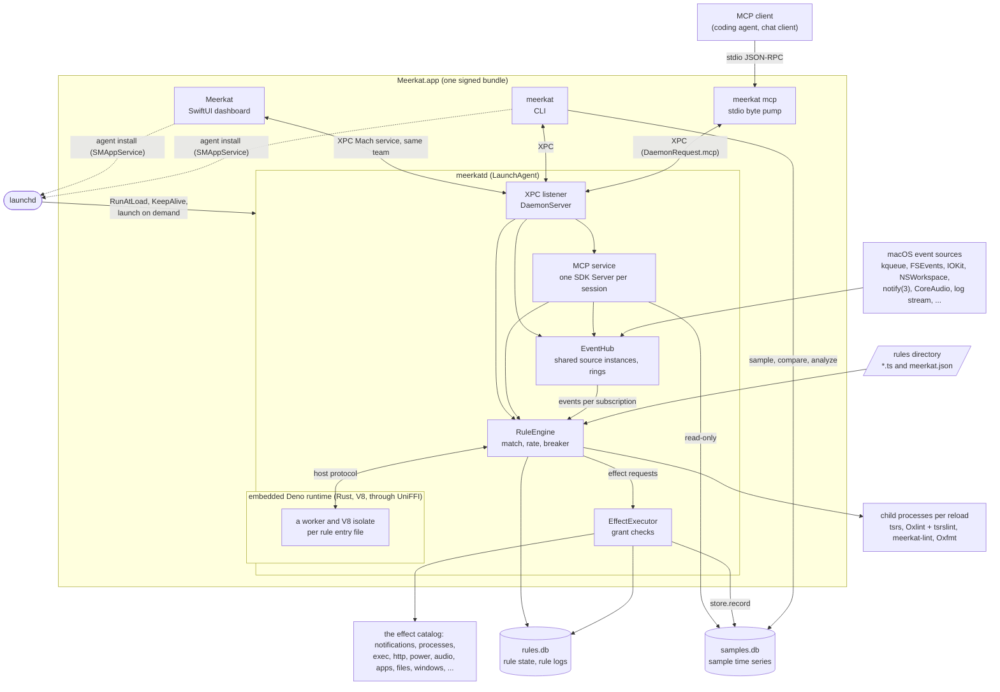
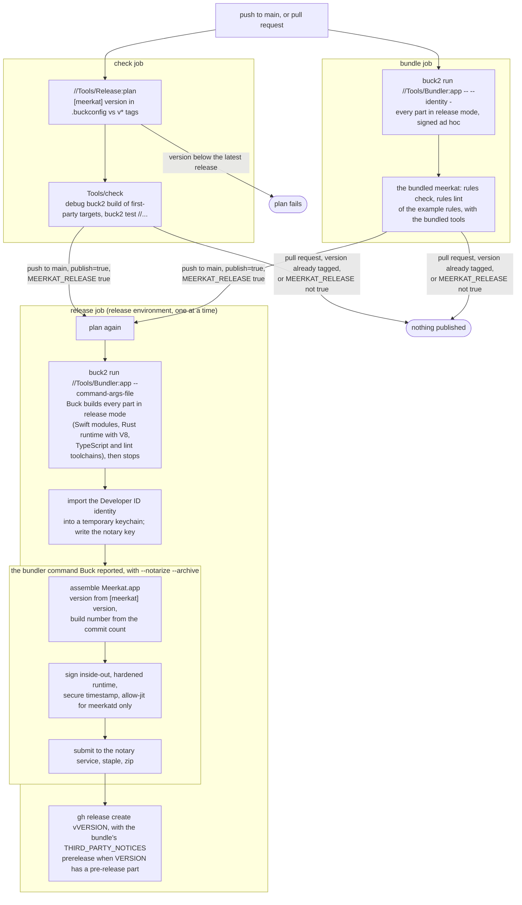

# Architecture

Meerkat is one signed macOS bundle with three executables: the dashboard
app, the `meerkat` CLI and `meerkatd`, a user LaunchAgent that observes
system events and runs the user's TypeScript rules against them. This page
is the map; the design documents are the authority for each part:

- [design/meerkatd.md](design/meerkatd.md): the daemon, the event catalog,
  the rule runtime, IPC and the bundle layout.
- [design/effects.md](design/effects.md): the effect catalog, its grants,
  what rules can change on the Mac, and what they may observe.
- [design/mcp.md](design/mcp.md): the daemon as a Model Context Protocol
  server.
- [design/rule-editor.md](design/rule-editor.md): the app's rule editor and
  dry runs of unsaved rule code.
- [design/remote-execution.md](design/remote-execution.md): building on
  another Mac, and what Buck2 remote execution would need.
- [design/app.md](design/app.md): the dashboard app: its models, feeds,
  failure handling and presentation rules.

[development.md](development.md) is how to change it: checks, style,
generated files, tests, releases and CI.

Contents: [Processes](#processes) · [Trust boundaries](#trust-boundaries) ·
[From event to effect](#from-event-to-effect) · [State on disk](#state-on-disk) ·
[Source tree](#source-tree) · [Build and release](#build-and-release)

## Processes

- **meerkatd** is the only long-running process. launchd starts it from the
  bundle's `Contents/Library/LaunchAgents/com.gkze.meerkat.daemon.plist`,
  which the app or the CLI registers through `SMAppService` (one
  implementation, `MeerkatAgent`). It owns the event hub, the rule engine,
  the embedded rule runtime, the effect executor, the rule store and the XPC
  listener with its MCP service.
- **The event hub** runs one source instance per event kind and canonical
  parameters, shared by every subscriber (rules, the dashboard, the CLI,
  MCP), started by the first and stopped by the last.
- **The rule runtime** is Deno, embedded in `meerkatd` as a Rust static
  library (`Sources/meerkat-runtime`)
  whose Swift API UniFFI generates. Each rule entry file runs on a worker
  thread with its own V8 isolate.
- **The rules toolchain** (tsrs, Oxlint with tsrslint, meerkat-lint, Oxfmt)
  runs as pinned child processes on each reload; nothing of it is linked
  into the daemon.
- **Clients.** The app, the CLI and `meerkat mcp` all reach the daemon
  through one XPC Mach service, `com.gkze.meerkat.daemon`. `meerkat mcp`
  copies MCP's JSON-RPC lines between stdio and XPC without parsing them;
  the MCP server itself runs in the daemon. One-shot measurement
  (`meerkat sample`) and the dashboard use the same kit samplers as the
  daemon's sources.

## Trust boundaries

Seven kinds of input are not trusted, and each is stopped at its own
boundary:

| Untrusted | Boundary | Enforced in |
|---|---|---|
| Rule code | A Deno worker per entry file: own isolate, 256 MiB heap limit, per-file read and write grants, process-wide ops disabled, the daemon's state, rules and bundle unwritable, and its state unreadable, by real path (`protected.rs`, checked with every rule's renames held off, with the APIs that write around it off), a watchdog that interrupts synchronous overruns and a file's sustained work outside its handlers. A file or rule that keeps ending the host is excluded or disabled. Memory outside the V8 heap and CPU spent inside invocations are not bounded per file, and a path another program swaps between a check and its call is not seen (meerkatd.md, "Known limits"). What rule code produces crosses as JSON text that the daemon decodes and checks, bounded per file. | `Sources/meerkat-runtime/src/worker.rs`, `watchdog.rs`, `protected.rs`; `HandlerHost`; `DaemonPaths.protected` |
| Effects a rule asks for | Accepted only during the rule's own invocation, then checked against the grants its definition declares, in the daemon, never in the runtime. | `RuleEngine` (per-rule effect queue), `EffectAuthorizer.admit` |
| What a rule subscribes to | Its kind's observation grant (`fs.read` over watched paths, `process.observe`, `observe.allow`), checked when the definition is decoded, so a rule without it never subscribes. `fs.churn` without a root measures `meerkat.json`'s file scope, which can change under a loaded rule, so its `fs.read` grant over that scope is checked where the rule subscribes, each time, and again when the scope changes: a rule it no longer covers fails. With `process.observe: "own"`, other users' processes are dropped from what the rule sees, at its dispatcher, before `match`. Each rule sees only its own file's `meerkat.dropped`, `meerkat.rule` and `meerkat.notification` events. | `ObservationScope` (`require`, `requireFileScope`), `RuleDefinition`, `RuleEngine.subscribe` and `recheckFileScope`, `ActiveRule`'s dispatcher, each payload's `viewed(by:)` |
| Unsaved rule code in a dry run | A request over XPC compiles a copy of the rules directory in the cache directory and runs the text in a handler host of its own, stopped at the end of the run. It has no `EffectExecutor`: effects are admitted as they would be live, then only simulated, and `fs.write` grants are dropped. | `RuleDryRunner`, `EffectSimulator` |
| Rule source on every save | The compiler and linters run as children with deadlines (SIGTERM, then SIGKILL); a rule that fails to type-check is not run. | `RuleCompiler`, `RuleLinter` |
| What the app's language server answers | The app runs the bundled tsrs as its own child process over stdio, with the rules directory as working directory, while the editor is open. A code action is offered only if all its edits are for the open file, need no command, fit the text without overlapping and change it. | `RuleLanguageServer`, `RuleFix.offered` |
| Other processes on the machine | The XPC peer requirement `.isFromSameTeam()`: only binaries signed with the bundle's team reach the daemon. | `DaemonServer`, `DaemonClient` |

Event payloads, rule logs and file paths come from other programs. Over MCP
they are returned as data, and the kinds most likely to carry text others
control (privacy-permission kinds, the raw kinds) are denied unless
`meerkat.json` allows them ([mcp.md, "Harm model"](design/mcp.md#harm-model)).

## From event to effect

An event is filtered in Swift before any JavaScript sees it, and anything
rule code wants done comes back to Swift to be checked and performed. The
sequence, with the details, is in
[meerkatd.md, "Effects"](design/meerkatd.md#effects); a rule's states from
save to running are in [meerkatd.md, "Rule states"](design/meerkatd.md#rule-states).

## State on disk

Rules and `meerkat.json`, the compiled rules, the rule store and the sample
store each have a default location and two ways to move it: the table is in
the [README, "Storage"](../README.md#storage).

`DaemonPaths` reads these when the daemon starts; the CLI reads the same
values. `meerkat.json` is read live: a saved change applies without a
restart.

## Source tree

`Sources/` holds every module, whatever its language; the README says how
they are named.

| Path | Role |
|---|---|
| `Sources/MeerkatKit` | Samplers, process catalog and identity, the event catalog (descriptors, payloads, parameters, schemas), event sources, the hub, predicate and rate-limit evaluation, `JSONValue`. No dependencies. |
| `Sources/MeerkatStore` | The sample store (normalized: the README, "Storage") and the rule store (state, logs). GRDB and SQLiteData. |
| `Sources/MeerkatIPC` | XPC messages, `DaemonClient` with reconnect and resubscribe, `DaemonPaths`, the `meerkat.json` schema. |
| `Sources/MeerkatAgent` | `SMAppService` registration, shared by the CLI and the app. |
| `Sources/MeerkatRules` | The rule compiler (tsrs) and linter over the bundled tools. The CLI uses it without the daemon. |
| `Sources/MeerkatDaemon` | Rule engine, handler host supervisor (over the `HandlerHostTransport` protocol, a test seam), the Deno runtime as its transport, effects, XPC server, MCP server. Only `meerkatd` and the daemon tests link it (and V8). |
| `Sources/CICU` | ICU's C regex API, for time-bounded `match` regexes. |
| `Sources/meerkat-runtime` | The embedded Deno runtime (Rust), the one static library `meerkatd` links, with std once: a worker per rule file, module loader, the `meerkat` module (`js/runtime.js`), console, watchdog, host protocol. `build.rs` composes the runtime's globals from Deno's libraries; `bindgen/` generates its C header (`CMeerkatRuntime`) and Swift API (`MeerkatRuntimeBindings`). |
| `Sources/meerkat-lint` | `meerkat-lint`, the `meerkat/*` lint rules (Rust); `policy/` is the Oxlint and Oxfmt policy rules folders share. |
| `Sources/meerkat-rules` | The rule-authoring workspace: the editor toolchain (`bun.lock`), the generated `meerkat.d.ts`, `deno.d.ts` and `meerkat.schema.json`, examples, a `tsconfig.json` matching the daemon's compiler options, and the TypeScript checks. |
| `Sources/meerkatd`, `Sources/meerkat`, `Sources/MeerkatApp` | The executables: the LaunchAgent, the CLI, and the SwiftUI dashboard. |
| `Tests` | Unit, live OS-boundary and end-to-end tests. |
| `Tools/Bundler` | Assembles, signs and notarizes `Meerkat.app` from the parts Buck builds; `AppIcon.icon` is its icon. |
| `Tools/Notices` | `THIRD_PARTY_NOTICES`, generated from what the bundle's parts reach (with `buck2/rules/notices.bzl`). |
| `Tools/Release`, `Tools/ReleaseVersion` | Decide whether a commit publishes a release. |
| `Tools/RemoteBuild` | Builds a bundle on another Mac and signs it locally. |
| `Tools/check` | Every format check, lint, build and test. |
| `buck2/rules` | Build rules (Swift in `swift/`, Rust, checks, conformance tests, notices, the bundle) and the Rust and C toolchain rules. |
| `buck2/platforms`, `buck2/mode`, `buck2/config` | The debug and release platforms, and the release mode file. |
| `buck2/toolchains` | The toolchains cell: Xcode's Swift and clang, Rust, Python for the prelude. |
| `buck2/conformance` | The checker that `Package.swift`, `Package.resolved` and `bun.lock` agree with the BUCK files, and the generator of the Swift tables. |
| `buck2/third_party` | Every third-party dependency, pinned by version and checksum: `rust/` (reindeer, crates.io; V8 as rusty_v8's release library), `swift/` (the SwiftPM packages from their pinned archives, `modules.bzl` generated from their manifests), `js/` (the TypeScript, Oxlint and Oxfmt release binaries), `tools/` (the release executables the checks run, none shipped, and `defs.bzl`'s `tool()`). |
| `docs/design` | Design records. |

## Build and release

Buck2 builds every first-party module and fetches every third-party dependency
at a pinned version and checksum. Crates and Swift packages build from source;
V8 and the TypeScript, Oxlint and Oxfmt tools are release binaries
(`.buckconfig`), and CodeEditLanguages' grammars are a prebuilt container.
Rust dependencies are in `buck2/third_party/rust/Cargo.toml`; first-party
crates have no Cargo manifests but a name-only
`Sources/meerkat-runtime/Cargo.toml`, which UniFFI's macros read for the crate
name. `Tools/check` builds every target outside `buck2/third_party`, whose
targets build as dependencies, in debug (the release bundles aside), then runs
`buck2 test //...`. CI also builds
the release bundle on a runner of its own, signed ad hoc, and runs the
bundled CLI's `rules check` and `rules lint`. A release is
decided by data in the repository, not by pushing a tag: `[meerkat] version`
in `.buckconfig` is the version, and a push to `main` that declares a
version with no `v<version>` tag yet publishes it.

Locally, `buck2 run //Tools/Bundler:app` runs the same bundler without
notarization and signs with a local identity (`--install` also installs and
registers the agent); `//Tools/Bundler:app-debug` builds the same bundle
from a debug build. `//Tools/RemoteBuild:remote` builds the parts on another
Mac and runs the bundler locally, where the signing identity is
([remote-execution.md](design/remote-execution.md)). The workflow is
`.github/workflows/ci.yml`; its secrets are listed at its top.
