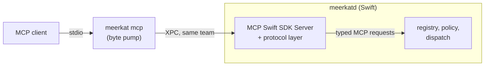
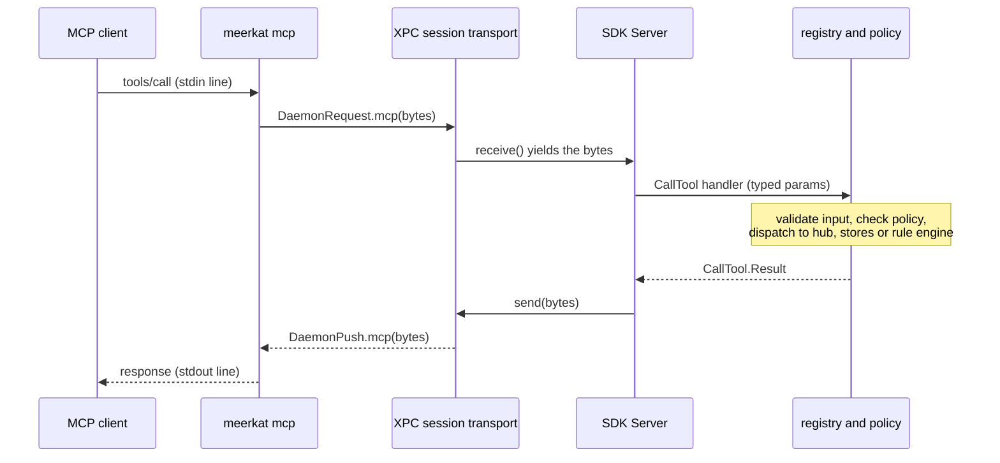
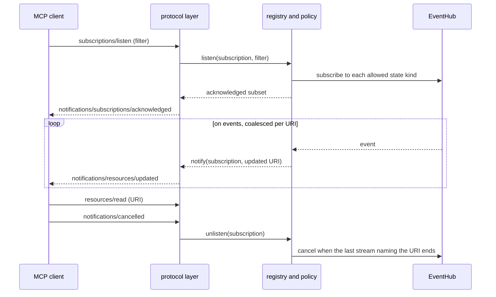

# meerkatd as an MCP server

Status: the transport, the protocol layer, the read-only resources, the tools
`events_sample`, `system_sample`, `samples_compare`, `resource_read`,
`rules_check` and `rules_dry_run`, the built-in prompts, and the policy in
`meerkat.json` are implemented. User-defined
tools (step 4), `subscriptions/listen` for event resources and built-in
state-changing tools (step 6), and per-client profiles are open ("Delivery
order"). This document records the design for exposing the daemon over the
Model Context Protocol and the decisions still open.
[meerkatd.md](meerkatd.md) stays the authority for the daemon, the catalog,
the rule runtime and the IPC this builds on; [../architecture.md](../architecture.md)
shows where the MCP service sits among the other processes.

Contents: [Task contract](#task-contract) ·
[What it builds on](#what-it-builds-on) ·
[Protocol version](#protocol-version) · [Design](#design) ·
[Harm model](#harm-model) · [Open decisions](#open-decisions) ·
[D1 evidence](#d1-evidence) · [Delivery order](#delivery-order)

## Task contract

Requested outcome: MCP clients (coding agents, chat clients) can read what
the daemon knows and observes, and call actions the user defines, with what
is exposed configurable at run time.

Acceptance criteria:

1. An MCP client connects to the running daemon without the daemon listening
   on a network socket by default.
2. A built-in, read-only surface: daemon status, the event catalog with JSON
   Schemas, the rule set with diagnostics and logs, stored samples, and
   bounded live sampling of events.
3. Tools, resources and prompts can be defined, changed and removed at run
   time without rebuilding or restarting the daemon, with clients told when
   the list changes.
4. Nothing reachable over MCP grants more than the user configured: no
   permission prompts, no rule authoring, and no effect without a declared
   grant, by default.
5. Every call is bounded in time, events, output size and concurrent
   subscriptions.

## What it builds on

| Need                                  | Provided by                                                                                                                                                                                                                                                       |
| ------------------------------------- | ----------------------------------------------------------------------------------------------------------------------------------------------------------------------------------------------------------------------------------------------------------------- |
| Authenticated local channel           | XPC Mach service `com.gkze.meerkat.daemon`, peer requirement `.isFromSameTeam()` (`DaemonServer.start`). The CLI inside Meerkat.app passes it.                                                                                                                    |
| Per-client lifecycle                  | Each XPC session owns its subscriptions; `Subscriptions.close()` ends them when the session is cancelled.                                                                                                                                                         |
| Live data                             | `EventHub.subscribe(kind, parameters)`: shared source instances, a ring per instance, `state` kinds replay their current value.                                                                                                                                   |
| Typed vocabulary                      | `EventCatalog`: one descriptor, payload `TypeSchema` and parameters `TypeSchema` per kind, with examples checked by `SchemaValidator`; `JSONSchema.document` projects them to JSON Schema.                                                                        |
| Rule state                            | `RuleEngine.report()` (rules, compile diagnostics, lint), `RuleEngine.logs`, `setEnabled`, `reload`.                                                                                                                                                              |
| History                               | `SampleStore` (`samples.db`): samples, top-N process rows, churn buckets.                                                                                                                                                                                         |
| Configuration                         | `meerkat.json` in the rules directory, read live by `DaemonSettings` (README, "Configuration").                                                                                                                                                                   |
| User code, sandboxed and hot-reloaded | The rules directory: type-checked by bundled tsrs, a Deno worker per entry file, deadlines, per-rule capability grants checked by `EffectExecutor`, observation grants checked at load and dispatch ([effects.md](effects.md), "Observation"), a circuit breaker. |

What is missing for the open steps:

- Reading event history. The hub's ring is in memory, per source instance,
  and not readable after the fact (meerkatd.md, "Sources and the hub").
- A way for user code to return a value to the daemon. `invoke` delivers an
  event; `invocationDone` reports only success or an error.

## Protocol version

The current MCP revision is
[2026-07-28](https://modelcontextprotocol.io/docs/learn/versioning). It
removes the `initialize` handshake: every request names its protocol version
in `_meta` (`io.modelcontextprotocol/protocolVersion`), the server accepts or
rejects each request on its own, and clients may call `server/discover` for
supported versions, capabilities and identity. Notification streams are
opened with `subscriptions/listen`, which replaces `resources/subscribe`.
Revisions up to `2025-11-25` use the handshake; below they are called the
initialize-based revisions, and a session opened with `initialize` an
initialize-based session (the specification calls them legacy).

Clients in use today may speak either, so the server must be what the
specification calls
[dual-era](https://modelcontextprotocol.io/specification/2026-07-28/basic/versioning.md#backward-compatibility-with-initialization-based-versions):
it answers `initialize` with initialize-based semantics and per-request
metadata with 2026-07-28 semantics. On stdio the era is chosen by how the
client opens, and it holds for the whole stdio process. Here that process is
one bridge, so the era holds for one XPC session.

2026-07-28 also deprecates [logging, sampling and roots](https://modelcontextprotocol.io/specification/2026-07-28/deprecated.md)
(earliest removal in the first revision on or after 2027-07-28). This design
uses none of them. Diagnostics go to the bridge's `stderr` and the daemon's
`os_log`.

The SDKs, as of 2026-10-26:

|           | [Swift SDK](https://github.com/modelcontextprotocol/swift-sdk)                                                                                                       | [rmcp](https://github.com/modelcontextprotocol/rust-sdk) (Rust)                                                                          |
| --------- | -------------------------------------------------------------------------------------------------------------------------------------------------------------------- | ---------------------------------------------------------------------------------------------------------------------------------------- |
| Version   | 0.12.1 released; [#314](https://github.com/modelcontextprotocol/swift-sdk/pull/314) open                                                                             | 3.7.0                                                                                                                                    |
| Revisions | Released: `2025-11-25`. #314 adds 2026-07-28 beside the initialize-based revisions.                                                                                  | 2026-07-28, compatible with `2025-11-25` and earlier (per its README)                                                                    |
| Server    | tools, resources, prompts, stdio and HTTP transports, custom `Transport`; with #314, `server/discover`, per-request version checks, `subscriptions/listen` over HTTP | tools, resources, templates, prompts, `subscriptions/listen`, custom transports from a `(Sink, Stream)` pair or `AsyncRead`/`AsyncWrite` |
| Runtime   | Swift concurrency                                                                                                                                                    | tokio                                                                                                                                    |

Supporting both eras is subtle, standardized behavior: version selection,
the initialize-based fallback, and two subscription models. That favors a
maintained implementation over one written here. The daemon uses the Swift
SDK with #314 pinned, and writes the parts #314 leaves to the server (D1,
"Inside the daemon").

## Design

### Transport: a stdio bridge in the CLI



The client is configured with the CLI as a stdio server:

```json
{
  "command": "~/Applications/Meerkat.app/Contents/MacOS/meerkat",
  "args": ["mcp"]
}
```

- No socket is opened. Authentication is the existing XPC peer requirement:
  only code signed by the same team reaches the daemon, and the bridge is
  that code. Whoever can start the bridge can already run the CLI as the
  user.
- One bridge process is one XPC session is one MCP client. When the client
  exits, stdin closes, the bridge exits, the session is cancelled, and every
  subscription that client held ends through the existing
  `Subscriptions.close()`.
- `launchd` starts the daemon on demand when the bridge connects, as it does
  for the CLI and the app.

**Daemon restarts.** The specification says a stdio server
holds no subscription state across reconnections, and a client that
reconnects must send `subscriptions/listen` again. The bridge cannot
reconnect for the client without parsing MCP. So the bridge checks the
daemon's pid and start time every 2 s and exits (status 69) when they change
or the daemon is unreachable. The client sees the transport close, restarts
the stdio server, and listens again (D6). A client line over the daemon's
4 MiB message limit ends the bridge with status 1 instead: the input is at
fault, and a new bridge would refuse it too.

A Streamable HTTP transport is a possible later addition for clients that
cannot start a process. It would need a bearer token (from the Keychain,
not a file), `Origin` checking against DNS rebinding, and a loopback-only
bind or a Unix socket. It is out of scope until a client needs it.

### Where the protocol lives: in the daemon

Two XPC messages carry MCP as opaque JSON-RPC bytes:

```swift
// DaemonRequest
case mcp(message: Data)          // one JSON-RPC message from the client
// DaemonPush
case mcp(message: Data)          // a response or notification for the client
```

The bridge only copies stdin lines into `DaemonRequest.mcp`, and
`DaemonPush.mcp` messages to stdout. It does not parse MCP. The daemon
queues MCP messages in the XPC handler, before any task, so their order is
the client's.

Rejected: implementing MCP in the CLI and translating each call into the
other `DaemonRequest` cases. The tools defined at run time live in the
daemon's rule engine, so the CLI would need a second request to list them
and a push to learn they changed; it would also own a second projection of
the catalog's schemas. The daemon would end up implementing most of the
protocol anyway.

### Inside the daemon: Swift, on the MCP Swift SDK

The whole server is Swift, in `MeerkatDaemon` (`MCP/`), on the official MCP
Swift SDK with #314 pinned (D1). Three parts, split by what each owns:

| Part                                    | Owns                                                                                                                                                                                                                                                                                                                                                                                                                                        | Does not own                                                         |
| --------------------------------------- | ------------------------------------------------------------------------------------------------------------------------------------------------------------------------------------------------------------------------------------------------------------------------------------------------------------------------------------------------------------------------------------------------------------------------------------------- | -------------------------------------------------------------------- |
| The SDK's `Server`, one per XPC session | JSON-RPC framing; `initialize` for initialize-based clients; `server/discover`; checking each 2026-07-28 request's `_meta` version and client capabilities; `UnsupportedProtocolVersionError` (`-32022`); `resultType` and server identity on 2026-07-28 results; cancellation; typed decoding of every MCP method.                                                                                                                         | Anything below.                                                      |
| The protocol layer (`MCP/Protocol/`)    | What the SDK leaves to the server on a transport other than HTTP: `subscriptions/listen` streams (acknowledgment, filter, tagging); caching hints on list results; sending unsolicited notifications only to initialize-based sessions; the version `initialize` agreed; rejecting a request that names no version outside an initialize-based session; mapping `resources/subscribe` onto the listen model; the XPC session's `Transport`. | Any registry, policy, schema or decision about what a client may do. |
| The server's meaning (`MCP/`)           | The registry of built-in and user-defined tools, resources and prompts; the policy (`meerkat.json`, profiles, event-kind allowlist, limits); JSON Schemas (from `TypeSchema` and user definitions); validating every call's input; dispatch to the hub, stores and rule engine; capability grants; per-session state beside `Subscriptions`; which streams get which notifications.                                                         | Wire format, protocol eras.                                          |

One call, end to end:



**One `Server` per XPC session.** The SDK's `Server` is per connection: it
holds that connection's initialize-based session state (`initialize`, its
client capabilities) and its in-flight requests. Each XPC session gets its
own `Server` and transport; the registry, policy and hub subscriptions are
shared. The transport's `receive()` yields each `DaemonRequest.mcp`, and
`send(_:)` becomes a `DaemonPush.mcp`. When the XPC session is cancelled
(client gone), the transport finishes its stream and the daemon calls
`Server.stop()`, which cancels the session's in-flight handlers, listen
streams included; the session's `Subscriptions` are released with them.

**The vocabulary is MCP's own.** Handlers receive the SDK's typed
parameters (`CallTool.Parameters`, `ListTools.Parameters`, ...) and return
its results, the same in both eras. A handler that needs to know the era
asks the protocol layer, which knows it from the request's client
capabilities (2026-07-28) or from `initialize`. The registry does not
branch on it: an initialize-based resource subscription and a 2026-07-28
listen stream reach it the same way.

**The protocol layer is the part to shrink.** It exists because #314 does
not cover these over a non-HTTP transport, and because the SDK keeps some
state private:

- _Listen streams._ #314 filters and tags listen streams only in its HTTP
  transport; its own `subscriptions/listen` handler only holds the request
  open, and it defines no `notifications/subscriptions/acknowledged`. The
  layer replaces that handler, sends the acknowledgment, and tags each
  notification with the stream's id. `Server.start` installs the SDK's
  handler, overwriting one registered earlier, so the layer registers after
  `start`, and the transport holds input back until it has.
- _Caching hints._ Only `server/discover` carries `ttlMs` and `cacheScope`
  in #314; `ListTools.Result` and the other list and read results do not
  (upstream issue #243), so the layer serves those methods through its own
  method types with them, `ttlMs: 0` while lists change at run time.
- _Initialize-based state._ The version `initialize` agreed is private to
  `Server`; the transport records it, applying the SDK's rule.
- _Unversioned requests._ The SDK serves a request with no version outside
  an initialize-based session as initialize-based, and its strict mode drops
  such a request with no response. The layer does not use strict mode and
  answers it with `-32602`.

Each part is removed when an SDK release covers it. Moving from the
pinned #314 commit to a release that carries 2026-07-28 is a pin change plus
deleting what the release makes redundant, checked by the protocol tests
(`Tests/MeerkatDaemonTests/MCPTests.swift`).

**The pin.** `Package.swift` and `//buck2/third_party/swift` pin the SDK
at #314's head commit (`aa545cb`, in `romanbsd/swift-sdk`, also reachable as
the upstream pull request's ref), by revision: the SDK depends on a branch
(swift-docc-plugin), which SwiftPM refuses under a version requirement.
The pin holds until a release carries 2026-07-28. A force-push of the branch
needs a new pin: the revision in `Package.swift` and
`buck2/third_party/swift/BUCK`, the archive's `sha256` in that `BUCK` file, and
`Package.resolved`.

**No Rust in the MCP path.** `//Sources/meerkat-runtime:meerkat_runtime` is the
rule runtime alone. Each Rust static library carries its own copy of the
standard library, so meerkatd links one Rust archive, and any Rust added
later goes into it as a dependency rather than a second archive.

### Built-in surface

Resources (read-only):

| URI                                   | Content                                                                                                                                                                                 | Backed by                                                  |
| ------------------------------------- | --------------------------------------------------------------------------------------------------------------------------------------------------------------------------------------- | ---------------------------------------------------------- |
| `meerkat://status`                    | Daemon version, pid, uptime, runtime state, running sources                                                                                                                             | `DaemonStatus`                                             |
| `meerkat://catalog`                   | Every event kind: descriptor, delivery semantics, permission                                                                                                                            | `CatalogEntry.entries`                                     |
| `meerkat://catalog/{kind}`            | One kind with payload and parameters as JSON Schema                                                                                                                                     | `AnyEventKind`, `JSONSchema.document`                      |
| `meerkat://types`                     | `meerkat.d.ts` for the running catalog                                                                                                                                                  | `TypeScriptDeclarations.render`                            |
| `meerkat://config`                    | `meerkat.json` as the daemon applies it: effective values, source, and the problem when the file does not apply                                                                         | `DaemonSettings.status`                                    |
| `meerkat://rules`                     | Rules, compile diagnostics, last lint                                                                                                                                                   | `RuleEngine.report`                                        |
| `meerkat://rules/{rule}/logs{?limit}` | A rule's log, newest first, as `{ entries, omitted }`: the newest entries within `limits.outputBytes`, and how many older ones were left out. The rule id (`file#name`) percent-encoded | `RuleEngine.logs` (limit clamped to 1–10 000; default 100) |
| `meerkat://samples`                   | Per-label summary: count, CPU, compressed memory, swap                                                                                                                                  | `SampleStore.labelMetrics`, read-only                      |
| `meerkat://samples/{label}{?limit}`   | The newest samples under a label (1–1 000, default 100)                                                                                                                                 | `SampleStore.recentMetrics`, read-only                     |
| `meerkat://events/{kind}`             | The current value of a `state` kind; updates through `subscriptions/listen`                                                                                                             | hub replay (step 6, not built)                             |

Reading the samples resources never creates the store: before anything is
recorded they are empty. An unknown URI, kind or rule is `-32002`.

Tools:

| Tool                | Hints                     | Does                                                                                                                                                                                                                                           |
| ------------------- | ------------------------- | ---------------------------------------------------------------------------------------------------------------------------------------------------------------------------------------------------------------------------------------------- |
| `events_sample`     | read-only                 | Subscribes to `kind` with `params`, collects until `maxEvents` or `maxSeconds`, unsubscribes, returns the envelopes and which bound stopped it, with the source's `reason` when it failed. Shares source instances like any subscriber. Built. |
| `system_sample`     | read-only                 | One measurement window, as `meerkat sample`: CPU, load, memory and the busiest processes, without path churn. Listed, and run, only while the policy allows `process.top`, `cpu.sample` and `memory.sample`. No host name. Shares the session's sample slots. |
| `samples_compare`   | read-only                 | Two labels of the sample store compared, as `meerkat compare`, over each label's newest `limit` (default 100) samples: medians, ranges, the change, overlapping and noisy metrics (`SampleComparison`, MeerkatStore). Reads the store read-only and never creates it. |
| `resource_read`     | read-only                 | Reads any resource above by URI, for clients that call tools but don't read resources. Its description lists the resources' own URIs and templates, so the two can't drift.                                                                  |
| `rules_check`       | read-only                 | Type-checks a given source as a file of the rules directory, against the running catalog and the files around it. Nothing runs or is written. Lint stays in `meerkat rules lint`.                                                              |
| `rules_dry_run`     | read-only                 | Runs a rule saved in the rules directory on its kind's example events, with effects captured. Takes a file name, never text.                                                                                                                   |
| `rules_reload`      | changes state, idempotent | `RuleEngine.reload`. Step 6.                                                                                                                                                                                                                   |
| `rules_set_enabled` | changes state, idempotent | `RuleEngine.setEnabled`. Step 6.                                                                                                                                                                                                               |

Not built in: effects (`process.signal`, `exec`, `http`, `notify`,
`store.record`) as tools of their own, and writing rule files. An action
reaches MCP only as a tool the user defines, with its grants declared in
code (below), or not at all.

`events_sample` is the tool clients will use most ("what is the memory
pressure", "watch `~/Downloads` for ten seconds"). Its bounds are part of
its contract: a ceiling on `maxSeconds` and `maxEvents`, a total output
size limit after which the result reports truncation, and a limit on
concurrent samples per session. The defaults are 30 s, 500 events, 1 MiB
and 4 samples (D4), with per-call defaults of 10 s and 100 events.
Its input schema enumerates exactly the kinds the policy allows, so a
client sees the boundary before it calls, and every argument is checked in
Swift before a source starts. A failed sample is a tool error
(`isError`), which the model can read; an unknown tool is `-32602`.

Every tool's reply is JSON text, and the same as structured content when
it is an object, which a reply cut to `outputKiB` still is. The one
exception is `resource_read` of `meerkat://types`, which is TypeScript and
comes back as text. Only
`events_sample` declares an `outputSchema`: the others' replies can be cut,
and a schema would then have to describe the cut form too.

`system_sample` exists so that a client with only MCP can follow
`meerkat-diagnose`, whose main step is measuring over a window. It reads
what three kinds carry without subscribing to them, so it is gated on the
policy allowing all three, and leaves out what none of them carries: path
churn, which would read paths under any folder a client named (`fs.churn`
through `events_sample` is where the policy decides that), and the DNS host
name, which `network.hostname` leaves out by design. Its sampler sleeps through the window on a
dispatch thread and can't be interrupted, so a cancelled call waits out a
window the policy bounds.

### Notifications: `subscriptions/listen`

A client opens a notification stream with `subscriptions/listen`. Its filter
names what it wants: `toolsListChanged`, `resourcesListChanged`,
`promptsListChanged`, and `resourceSubscriptions` (a list of URIs). The
server must not send anything the filter did not ask for. It acknowledges
with `notifications/subscriptions/acknowledged`, listing the subset it will
honor, and tags every notification with the stream's id
(`io.modelcontextprotocol/subscriptionId`, the JSON-RPC id of the `listen`
request). A client may hold several streams at once. Each ends when the
client sends `notifications/cancelled` for it, when the transport closes, or
when the server ends it with a `complete` result.



How each part maps onto the daemon:

- The protocol layer owns the stream mechanics: the acknowledgment and
  tagging, with cancellation and the `complete` response from the SDK
  (`completeSubscriptionsListen`). The registry gets `listen(subscription,
filter)` and `unlisten(subscription)` and decides the acknowledged subset.
  A URI is acknowledged only if it names a `state` kind the policy allows,
  so `meerkat://events/log.entry` is dropped from the acknowledgment rather
  than failing the stream.
- For each acknowledged `meerkat://events/{kind}` URI, Swift subscribes to
  the hub as any client does, sharing the source instance. Events become
  `notifications/resources/updated`, coalesced to at most one per URI per
  interval (D4), because `fs.change` and `process.*` can produce thousands
  a second. The update says only that the resource changed; the client
  reads the new value with `resources/read`.
- Several streams on one session that name the same URI share one hub
  subscription, counted by reference. The last `unlisten` for that URI
  cancels it.
- When the daemon stops, each session's `Server` answers every open
  `listen` with `complete` (`completeAllSubscriptionsListen`) before the
  session closes, so clients can tell a clean end from a dropped
  connection.
- Initialize-based clients (`2025-11-25` and earlier) use
  `resources/subscribe`, `resources/unsubscribe` and unsolicited
  list-changed notifications. The SDK exposes those methods as their own
  handlers; the protocol layer maps them onto the same `listen` and
  `unlisten` calls, so the registry has one model.

### Run-time configuration: the rules directory

Tools, resources and prompts the user defines are TypeScript exports in the
rules directory, next to rules:

```ts
import { tool } from "meerkat";

export const throttleHogs = tool({
  name: "throttle_hogs",
  description:
    "Move processes writing more than `above` MB/s to the background band.",
  input: { above: { type: "number", minimum: 1 } },
  capabilities: { process: { priority: true } },
  annotations: { readOnlyHint: false, destructiveHint: false },
  timeoutSeconds: 10,
  async handle(input, ctx) {
    // input is typed from `input`; ctx has the granted effects only
    return { moved: [] };
  },
});
```

This reuses, unchanged in meaning, everything rules already have:

- type checking at load, so a tool with a type error is not offered;
- hot reload on save, single-flight, unchanged definitions kept;
- a Deno worker per entry file, with load and invocation deadlines enforced
  by the runtime's watchdog;
- capability grants declared in the definition and checked by
  `EffectExecutor` for each effect, during the tool's own invocation only;
- per-rule logs and state, the circuit breaker, and `meerkat.rule` events.

The id follows rules: `<entry file>#<name>`. The MCP tool name is `name`,
which must be unique across all entries; two entries exporting the same
`name` both fail to load, as two rules with one name in one file do.

A reload that changes the set of tools, resources or prompts, or any
definition's schema or description, sends `notifications/tools/list_changed`
(and the resource and prompt equivalents) on every listen stream whose
filter asked for it.

What `tool()` needs (step 4, not built):

| Layer                                                                                                 | Change                                                                                                                                                                                      |
| ----------------------------------------------------------------------------------------------------- | ------------------------------------------------------------------------------------------------------------------------------------------------------------------------------------------- |
| `Sources/meerkat-runtime/js/runtime.js`                                                               | `tool()`, `resource()`, `prompt()` constructors; collected from exports like rules; a handler that returns a value.                                                                         |
| `Sources/meerkat-runtime/src/protocol.rs` (its Swift side is generated into `MeerkatRuntimeBindings`) | `DaemonToHost::Call { invocation, target, input, timeout_seconds }` and `HostToDaemon::CallDone { invocation, result, error }`; `EntryResult` carries the new definitions.                  |
| `MeerkatDaemon`                                                                                       | Decode and check the definitions (as `RuleDefinition` does), validate each call's input against its schema before it reaches JavaScript, and own the registry and its change notifications. |
| `RuleAPIDeclarations` / `meerkat.d.ts`                                                                | Types for the new constructors and their contexts.                                                                                                                                          |

The server's parts and their state:

| Layer                                        | Part                                                                                                                                                                             | State                                                                                                                                                                 |
| -------------------------------------------- | -------------------------------------------------------------------------------------------------------------------------------------------------------------------------------- | --------------------------------------------------------------------------------------------------------------------------------------------------------------------- |
| `Package.swift`, `//buck2/third_party/swift` | The MCP Swift SDK at #314's head commit, by revision; `MeerkatDaemon` depends on its `MCP` module.                                                                               | Done                                                                                                                                                                  |
| `MeerkatDaemon` (`MCP/Protocol/`)            | The protocol layer: the XPC session's `Transport`, listen streams, caching hints, era gating, the initialize-based version, unversioned requests, `resources/subscribe` mapping. | Done except era-gated unsolicited notifications and `resources/subscribe` mapping, which have nothing to carry until step 4 or 6 (`SessionTransport`, `MCPProtocol`). |
| `MeerkatDaemon` (`MCP/`)                     | Registry, policy, dispatch; one `Server` per XPC session.                                                                                                                        | Read-only built-ins and the policy from `meerkat.json` (`MCPService`, `MCPPolicy`, `EventSampler`, `MCPEndpoint`)                                                     |
| `MeerkatIPC`, `DaemonServer`                 | `DaemonRequest.mcp`, `DaemonPush.mcp`; the session's transport finishes when the XPC session is cancelled.                                                                       | Done                                                                                                                                                                  |
| `meerkat` CLI                                | `meerkat mcp`: the byte pump; exits when the daemon restarts.                                                                                                                    | Done (`MCPBridge`)                                                                                                                                                    |

The MCP server's own policy is `meerkat.json`'s `mcp` section, in the rules
directory (D3; README, "Configuration"):

```json
{
  "$schema": "./.meerkat/meerkat.schema.json",
  "mcp": {
    "events": { "allow": ["log.entry"], "deny": ["fs.change"] },
    "limits": {
      "sampleSeconds": 30,
      "sampleEvents": 500,
      "outputKiB": 1024,
      "concurrentSamples": 4
    }
  }
}
```

`allow` admits kinds the default denies (permission kinds, the raw kinds);
`deny` removes any kind and wins. Both take kinds or `family.*`, enumerated
in the schema from the catalog, so a misspelt kind fails validation. The
limits have ceilings in the schema (300 s, 10 000 events, 16 MiB, 32
samples), so no file makes a call unbounded. A permission kind still needs
its grant: `events_sample` checks the status and fails without prompting.
The service reads the policy on every request, so a saved file applies to
the next one, on sessions already open. Rule code cannot write the rules
directory or the defaults domain (`DaemonPaths.protected`), so no handler
can widen the policy. Built-in state-changing tools would be switched on in
the same section when they exist (step 6).

Not yet: a tool list that changes with the policy is not announced
(`notifications/tools/list_changed`); clients see the new `kind`
enumeration when they list tools again (every list result says `ttlMs: 0`).

The client's self-reported identity (`clientInfo`) is not authenticated:
every MCP client reaches the daemon through the same signed bridge. A policy
that differs per client must be chosen by whoever configures the client, for
example `meerkat mcp --profile readonly`, which names a profile defined in
the policy (D5).

## Prompts and skills

The built-in prompts are the agent skills: `AgentSkill` (MeerkatKit) holds each
one's text, `meerkat skills` writes it as a `SKILL.md`, and `prompts/get` returns
it, so a CLI agent and an MCP client read the same instructions. They say how to
work and point at the live catalog rather than copying it, and tests parse each
command and resolve each `meerkat://` URI and tool they name.

## Harm model

- **Authoring rules is privilege escalation.** meerkatd.md protects the
  rules directory because a rule that could write rules could widen its own
  grants. The same holds for an MCP client: writing a rule file grants that
  client every capability a rule can declare, including `exec` and `http`.
  No built-in tool writes the rules directory. If this is ever added, it
  must be opt-in in the policy and confirmed by the user outside the model's
  control (D7).
  Running what a client supplies is the same escalation, so a dry run over
  MCP is narrower than the CLI's. `meerkat rules dry-run` runs any text, but a
  draft's code runs with whatever grants it declares, and it is the user at
  that command line. `rules_check` takes text and only compiles it, which
  reports what the compiler says about the rules folder's files, such as
  whether an import of one exists. The compile reads no file outside them
  (`noResolve`), so its diagnostics say nothing of other files on the Mac,
  not even whether one exists. `rules_dry_run` runs and takes no text: only code the user
  already has in the rules directory, on example events a client can't choose.
  Sampled events are left out because the policy may deny the rule's kind, and
  values read with `state.get` because stored state isn't readable over MCP. A
  rule can still log what it reads, and rule logs are readable.
- **Event data is sensitive and untrusted.** `log.entry` can carry
  anything an app logs; `window.focused` carries window titles; `fs.change`
  carries paths; `network.wifi` can carry the network name. All of it is
  text other people control, and it goes straight to a language model, so it
  can carry a prompt injection. Defaults: kinds that need a privacy
  permission and the raw kinds (`darwin.notification`,
  `distributed.notification`, `iokit.*`, `log.entry`, `power.assertions`) are denied until the
  policy allows them; results are returned as data (structured content), never
  as instructions. MCP keeps this policy of its own: rules' observation
  grants ([effects.md](effects.md), "Observation") do not apply to clients.
  Every kind a rule must name to observe is denied by this default, needs a
  permission, or is open for a reason MCPTests states (`camera.inUse` and
  `audio.inUse` carry device names, as the open `audio.devices` does;
  `pasteboard.changed` carries a counter; `session.logins` carries user
  names, terminals and a remote login's host), so a new one can't be open
  without a decision.
- **No permission prompts from MCP.** Subscribing over MCP to a kind that
  needs a TCC permission the user has not granted fails with the Settings
  pane, as it does for a rule, and never shows a prompt attributed to
  Meerkat.app at a moment the user did not choose.
- **Mutations are marked.** Every tool carries MCP annotations: today all
  are `readOnlyHint`, and a tool that changes state will carry
  `destructiveHint` and `idempotentHint`, which mean something only then, so
  clients that ask before running a destructive tool can. Built-in
  mutations are limited to reloading and enabling rules.
- **Bounded cost.** Per call: deadline, event count, output size. Every
  resource read and tool reply over `outputKiB` is cut to it, as an
  object with `truncated`, the whole reply's `bytes`, the limit as
  `outputBytes` and its first part as `text`; the rule log keeps its shape by
  leaving out older entries instead. `events_sample` keeps its shape by
  leaving out later events: its events stay within `outputKiB`, and the
  reply around them (the parameters, and the same result as text and as
  structured content) adds to that. Per
  session: concurrent samples, listen streams and the URIs they name. Shared sources
  mean a client sampling `cpu.sample` costs nothing extra while the
  dashboard runs it.

## Open decisions

| #   | Decision                                                                   | Options                                                                                                                                                             | Leaning, and what would decide it                                                                                                                                                                                                                                                                                                                                                                                                                                                                                                                                   |
| --- | -------------------------------------------------------------------------- | ------------------------------------------------------------------------------------------------------------------------------------------------------------------- | ------------------------------------------------------------------------------------------------------------------------------------------------------------------------------------------------------------------------------------------------------------------------------------------------------------------------------------------------------------------------------------------------------------------------------------------------------------------------------------------------------------------------------------------------------------------- |
| D1  | Protocol implementation (Swift owns the server and policy in every option) | rmcp as a protocol adapter behind a C ABI, in the one `staticlib`; Swift SDK behind a custom `Transport`; a dual-era JSON-RPC layer written in Swift                | Decided: the official MCP Swift SDK, with its 2026-07-28 pull request #314 pinned by commit until a release carries 2026-07-28; no Rust in the MCP path ("Inside the daemon", "D1 evidence"). Revisit if #314 is closed unmerged or its API changes in review: then rebase the protocol layer on what lands, or serve only `2025-11-25` until a release.                                                                                                                                                                                                            |
| D2  | Input schema vocabulary for user tools                                     | JSON Schema literals typed by a TS `FromSchema`-style helper; the catalog's `TypeSchema` vocabulary exposed to TS; a small purpose-built builder                    | Whichever the daemon can validate without a general JSON Schema engine. A subset decoded like `MatchPredicate` keeps validation in Swift and the inferred TS type exact.                                                                                                                                                                                                                                                                                                                                                                                            |
| D3  | Where the MCP policy lives                                                 | `mcp()` export in the rules directory; a separate `~/.config/meerkat/mcp.ts`; settings in `rules.db` managed by the CLI and app; a JSON file in the rules directory | Decided: `meerkat.json` in the rules directory, data checked against a schema generated from `MeerkatConfiguration.schema` (Swift is the authority; the JSON Schema is projected from it and checked in). It applies without the rule compile, so a rule's type error cannot hold back a policy change; no code runs in the policy path; and a file that fails validation keeps the last version that applied. `TypeSchema` validates it and projects its JSON Schema, so a TypeScript export would add nothing. Profiles (D5) would be a section of the same file. |
| D4  | Limits                                                                     | Values for sample seconds, events, output bytes, concurrent samples, update coalescing interval                                                                     | Measure against the dashboard's workload; start conservative (30 s, 500 events, 1 MiB, 4 samples, 1 s).                                                                                                                                                                                                                                                                                                                                                                                                                                                             |
| D5  | Per-client profiles                                                        | `--profile` on the bridge; one policy for all clients                                                                                                               | Profiles, if more than one client is expected with different trust.                                                                                                                                                                                                                                                                                                                                                                                                                                                                                                 |
| D6  | Daemon restart while a client is connected                                 | Bridge exits (client restarts it and listens again); daemon-side resumable session ids; bridge replays subscriptions                                                | Exit. The specification already requires a reconnecting stdio client to send `subscriptions/listen` again, and the server holds no subscription state across reconnections.                                                                                                                                                                                                                                                                                                                                                                                         |
| D7  | Rule authoring over MCP                                                    | Never; opt-in with confirmation in the app; opt-in with MCP elicitation                                                                                             | Never for now. Elicitation is shown by the client, which the model drives, so it is not an independent confirmation.                                                                                                                                                                                                                                                                                                                                                                                                                                                |
| D8  | Event history                                                              | Sampling only; persist chosen kinds to SQLite; expose the ring by sequence number                                                                                   | Sampling only until a client needs "what happened in the last hour"; then persist chosen kinds, which the store already has the shape for.                                                                                                                                                                                                                                                                                                                                                                                                                          |
| D9  | User-defined resources and prompts                                         | Ship with tools; tools first                                                                                                                                        | Tools first. Resources defined in code need their own read deadline and caching rules.                                                                                                                                                                                                                                                                                                                                                                                                                                                                              |

## D1 evidence

Both SDK paths were prototyped behind the same scripted driver, which runs
a session of each kind (initialize-based, 2026-07-28, and a discover probe
followed by `initialize`) and checks version selection, `-32022` for an
unsupported version, `-32602` for an unversioned request, listen-stream
acknowledgment and tagging, caching hints and run-time tool lists (25
checks). Its checks are now in `Tests/MeerkatDaemonTests/MCPTests.swift`.

- **rmcp** (3.7.0), as an adapter in the one Rust static library with Swift
  owning the tool list, passed every check. It handles both eras on one
  stream itself, but gates neither unsolicited notifications by era nor
  maps `resources/subscribe` onto `listen`, validates nothing against tool
  schemas, and brought tokio and ten more crates into the daemon's Rust
  build.
- **The Swift SDK with #314** (`0ffb9e5`, based on upstream `main` with no
  upstream commit missing; the SDK's own 582 tests pass on it) passed every
  check. It answers `server/discover`, checks each request's version and
  client capabilities, returns `-32022`, adds `resultType` and server
  identity, and ends listen streams with `complete`. What it leaves to the
  server is the protocol layer described under "Inside the daemon".
- An unofficial single-maintainer fork that carried 2026-07-28 also passed,
  but left discover, version checks and `-32022` to the server as well, and
  lagged upstream by 14 commits.

The Swift SDK was chosen: the whole server, its policy and its transport
are one language with the rest of the daemon, no async Rust runtime runs in
`meerkatd`, and the protocol layer is expected to shrink as SDK releases
cover it.

## Delivery order

1. Done: D1 (above).
2. Done: JSON Schema projection of `TypeSchema` (`JSONSchema.document`,
   draft 2020-12, named objects under `$defs`), checked against every
   catalog example and against `SchemaValidator`'s strictness by a
   validator that knows only the keywords it emits.
3. Done: the protocol layer on the Swift SDK (the XPC session's transport,
   one `Server` per session), `DaemonRequest.mcp` / `DaemonPush.mcp`, the
   `meerkat mcp` bridge, and the read-only built-in resources and
   `events_sample`. Checked against a real MCP client with an installed
   debug build: the client connected through `meerkat mcp`, called
   `events_sample` and read `meerkat://status`. Scripted sessions through
   the installed bridge, in both eras, read every resource and sampled
   `memory.pressure`, `cpu.sample`, `power.source` and `fs.change`; the
   daemon's sources returned to the rules' own once they ended.
4. `tool()` with the runtime protocol additions, input validation, and
   `list_changed`.
5. Done without profiles: the policy is `meerkat.json`'s `mcp` section,
   live (D3). Profiles (D5) are open.
6. `subscriptions/listen` for `meerkat://events/{kind}`, built-in
   state-changing tools, user resources and prompts, as D-items settle.

Separately, when a Swift SDK release carries 2026-07-28: move the pin to
it, delete what it makes redundant in the protocol layer, and rerun the
protocol tests.

Each step is testable without an MCP client, at the cheapest layer that
can catch its failure:

- the protocol layer and era handling, by Swift tests that run a `Server`
  over an in-memory transport through recorded initialize-based, 2026-07-28
  and probe-then-initialize sessions;
- the registry and policy, by daemon tests that call the handlers
  directly (the daemon tests already run real rules end to end).

The closest faithful consumer check is a real MCP client configured with
the bridge, run against an installed build.
