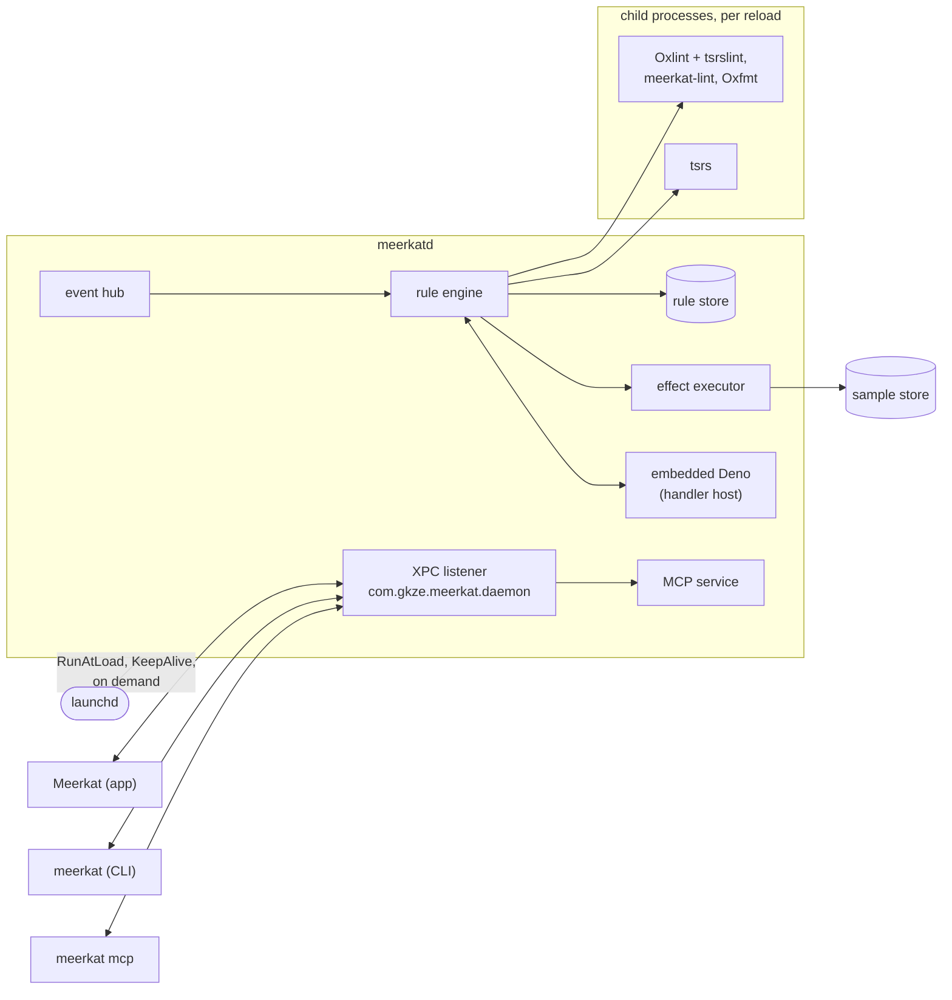
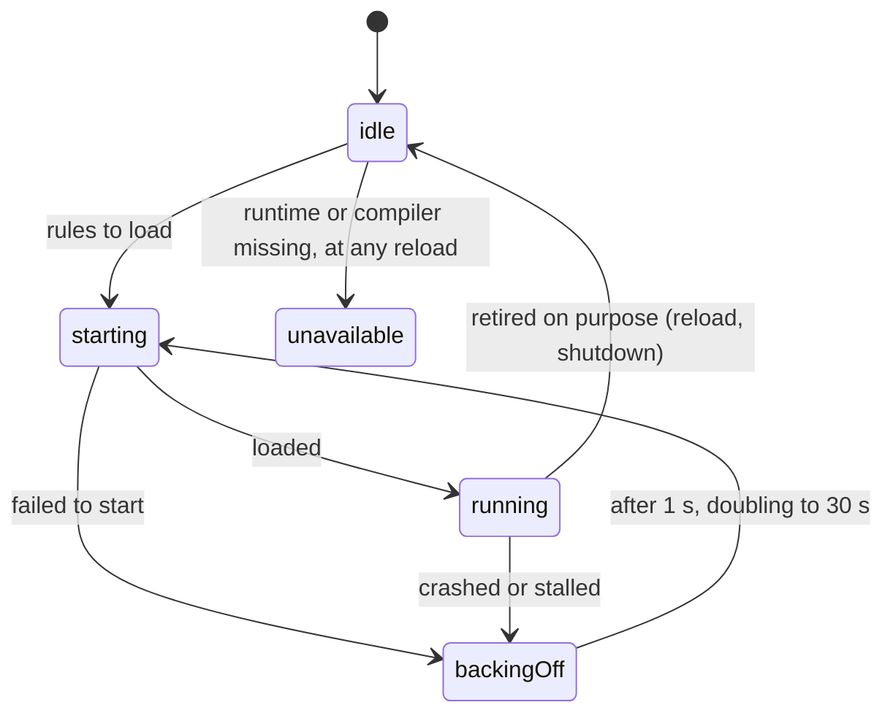
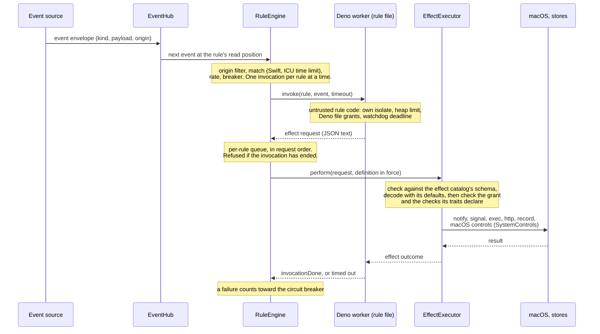
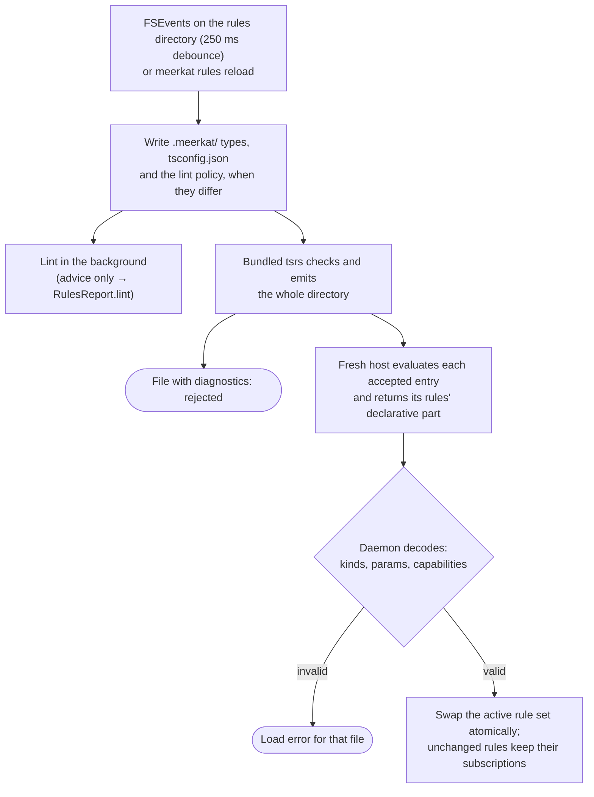
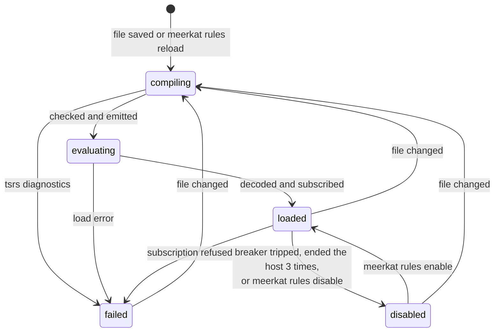
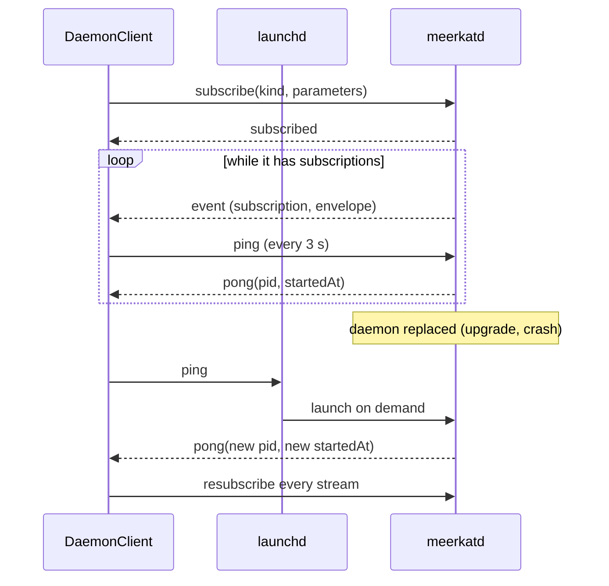
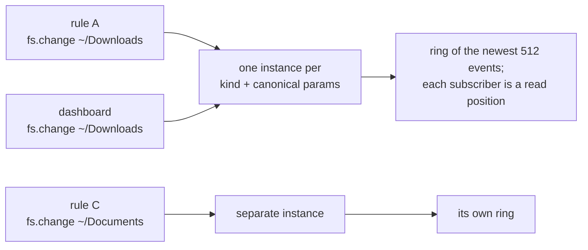

# meerkatd: system events, TypeScript rules, one daemon

Status: implemented; this document is the design authority for the
daemon, the event catalog, the rule runtime and the bundle layout. When code
and this document disagree, one of them has a bug. For the map of the whole
system (processes, trust boundaries, build and release), see
[../architecture.md](../architecture.md).

Contents: [Task contract](#task-contract) ·
[Evidence behind the decisions](#evidence-behind-the-decisions) ·
[Processes and bundle](#processes-and-bundle) ·
[Module layout](#module-layout) · [Events](#events) · [Rules](#rules) ·
[IPC](#ipc) · [Sources and the hub](#sources-and-the-hub) ·
[Process identity](#process-identity)

## Task contract

Requested outcome: a user daemon that observes system events nobody controls
and runs handlers the user does control, configured at run time through a
strongly typed TypeScript API, with the kit, the CLI and the app aligned on it.

Acceptance criteria:

1. One LaunchAgent, `meerkatd`, installed and removed through one mechanism
   (`SMAppService`) whether the CLI or the app does it.
2. An event catalog covering what macOS exposes to an unprivileged user
   process, plus what it exposes behind a privacy (TCC) permission the user
   grants, requested only when a rule subscribes, plus the network filter,
   a system extension the user turns on ([network-filter.md](network-filter.md));
   each event's delivery guarantees and permission are stated in its
   descriptor and in the generated TypeScript types.
3. Rules are `*.ts` files in `~/.config/meerkat/rules/`, hot-reloaded on
   change, type-checked at load (a rule that fails to type-check is not run),
   executed in an isolated, interruptible runtime the daemon can restart.
4. Handlers act only through capabilities the rule declares, and a rule
   observes only what it declares; the daemon enforces each grant.
5. The app and the CLI are clients of the daemon for live data; one-shot CLI
   measurement and the app's dashboard use the same kit sampling code as the
   daemon's sources.
6. Swift 6 language mode, latest tools version and dependencies throughout.

Settled decisions: the same install mechanism for CLI and app; the app is
a daemon client; rules live in `~/.config/meerkat/rules/`; Swift 6 and
latest versions everywhere; cover the system's event catalog broadly.

## Evidence behind the decisions

Each was checked with a spike on macOS 27.0.1 / Xcode 27.1 / Swift 6.4.

| Question | Finding |
|---|---|
| Can a CLI register the agent with the same mechanism as the app? | Yes. A CLI inside the signed bundle, even run through a symlink, calls `SMAppService.agent(plistName:).register()`; status went straight to `.enabled`. `Bundle.main` is wrong under a symlink, so code must not locate resources through it. |
| IPC between daemon and clients | A `MachServices` entry in the bundled agent plist plus Swift `XPCListener`/`XPCSession` with `Codable` messages: launch on demand, request/reply and server push all work. `.isFromSameTeam()` rejected an ad-hoc-signed client. |
| Type-check rules at load | tsrs, the Rust port of TypeScript 7's compiler, checks and emits a rules directory in ~60–200 ms (see "Why tsrs"). `moduleDetection: force` gives each file its own scope. |
| Do we need esbuild or another bundler? | No. The daemon needs check + emit, which the compiler (tsrs) does; its output (`module: esnext`, `moduleDetection: force`, so every file is a module) is served to the runtime from memory by its own module loader (`Sources/meerkat-runtime/src/loader.rs`). Bundler speed is irrelevant at this size; type checking dominates. |
| JavaScriptCore as the runtime | ES2025 built-ins, Promises with microtask drain after `evaluateScript`, WebAssembly. No timers, `TextEncoder`, `fetch` or public module loader, and no public execution time limit. JIT is disabled unless the binary carries `com.apple.security.cs.allow-jit` (30 M-iteration loop: 657 ms without, 120 ms with). |
| Process events without privileges | kqueue `EVFILT_PROC` with `NOTE_EXIT`/`NOTE_FORK`/`NOTE_EXEC` attaches to every pid, including root's. `sysctl(KERN_PROC_ALL)` returns pid, ppid, uid, start time and command for all processes; `proc_pidinfo` and `proc_pid_rusage` refuse other users. |

### Why embedded Deno

Rules run in Deno, embedded in `meerkatd` (`Sources/meerkat-runtime`, Rust,
exported to Swift through UniFFI; see "The host protocol: generated
bindings"). What makes an in-process runtime acceptable:

- V8 can interrupt running JavaScript from another thread
  (`IsolateHandle::terminate_execution`), so a stuck loop is stopped without
  killing a process.
- Each rule file runs on a worker thread of its own, with its own V8 isolate,
  its own heap limit (256 MiB; past it that file's worker is stopped rather
  than letting V8 abort the daemon) and its own Deno permissions. Memory
  outside the heap is not limited per file (see "Known limits, accepted").
- Deno's permission model gives per-file read and write grants; ops that act
  on the whole process (exit, abort, signals, `chdir`, V8 flags, inspector,
  native code, workers) are disabled outright, because several are reachable
  without any permission (`Sources/meerkat-runtime/src/worker.rs`, `PROCESS_WIDE_OPS`).
  So are Web Locks, one table for the whole process through which one file
  could see, block or steal another's (`CROSS_FILE_OPS`).
- Deno compares a path with its deny list as text, so it cannot keep rule
  code off the daemon's own files: a symlink into the rules folder from a
  granted one, or renaming the rules folder's parent away, would get past
  it. The file system each worker uses (`protected.rs`) refuses every change
  at, inside or above a protected path by real paths, resolved on each call,
  and changes to a file with a second hard link. A protected path is held by
  every name on its way: as named, by each symlink it passes through (a
  stow-style link to the folder holding the rules folder, the rules folder's
  own link), and where it leads, so no link on the way, nor the folder
  holding one, can be moved for a folder of the rule's own to take its
  place. `meerkat.json` is listed beside the rules folder, so a settings
  file linked out of it (a dotfiles setup) is protected where it leads. A
  real path is the one the kernel names: symlinks resolved, and a folder's
  other names mapped to it (a firmlinked folder's under the data volume,
  `/System/Volumes/Data/Users` for `/Users`; `/.nofollow/…`; `/.vol/…`),
  which `realpath` leaves alone. The data volume's mount point counts as
  above every folder on it, and names are compared without case, as APFS
  compares them by default. The daemon's own checks (`CapabilityGrants`, for
  watched paths and the path effects) compute the same forms in Swift
  (`CapabilityGrants.forms`, `canonicalPath`); one table of cases,
  `protected_cases.json` beside `protected.rs`, is run by both test suites
  so the two cannot drift. It holds reads to real paths the same way:
  nothing at or inside the state folder is read, opened, listed or looked
  at, through a symlink in a read grant or by a real path the daemon names
  through a symlinked parent; reading the folder above it shows only its
  name. Each checked call holds off every rule's renames from its check to
  its end, so rule code cannot swap a folder between the two, and a file
  opened only to read cannot have its mode, owner or times changed through
  its descriptor. Deno APIs that write files without it are off. KV, SQLite
  backups, Deno's Unix socket listeners and `node:fs`'s `cp` (which clones a
  folder with `clonefile(2)`, and copies a symlink by making one) are ops,
  switched off (`UNGUARDED_WRITE_OPS`, which also records what was audited,
  to audit again when `deno_runtime` moves; a test fails if a switched-off
  name is no longer an op). So is file watching (`Deno.watchFs`, and
  `node:fs`'s `watch` on it, `UNGUARDED_READ_OPS`): FSEvents watches
  recursively, around the guarded file system, so a watch through a symlink
  or above the state folder would report what changes in it. Rules watch
  files with the `fs.change` event. `node:sqlite` databases and `node:wasi`
  are native classes no op switch reaches, so the polyfills' exports are
  replaced before any rule code runs (runtime.js, `refuseUnguardedWrites`);
  `import` and `process.getBuiltinModule` read that one object, a dynamic
  `import()` meets the rules' loader, and `Deno[Deno.internal]` no longer
  holds the classes. `node:net` listening on a socket path needs Deno's net
  permission, which no rule is given.
- `deno_node` ops that read services the daemon does not give its workers
  (a Node resolver, a CommonJS loader) are off (`NODE_SERVICE_OPS`): each
  would panic inside V8's call and abort the daemon, and rule code reaches
  them through `createRequire` or `process.constrainedMemory()`. Rules are
  ES modules, so `require` throws.
- The daemon and the runtime speak only messages
  (`Sources/meerkat-runtime/src/protocol.rs`), and what rule code produces crosses as JSON
  text that the daemon decodes and checks, so user code stays on the far
  side of the boundary.

What it costs: a fault in V8 or Deno itself, rather than in rule code,
takes the daemon down with it; launchd's `KeepAlive` restarts it. That
includes a panic in one of Deno's ops: V8 calls each op as an `extern "C"`
function, and a panic unwinding out of one aborts the process. Only panics
in the worker's own setup and in async ops' futures are caught and reported
as the file's fault.

Rejected alternatives, each with the decisive reason:

- **JavaScriptCore in a child process.** Isolated, but without timers,
  `fetch`, a module loader or per-file permissions, each of which the host
  would have to supply; and the daemon would supervise a second process for
  what V8's `terminate_execution` gives in process.
- **JSContext inside the daemon.** JavaScriptCore has no public execution
  time limit, so a `while (true) {}` handler would wedge the daemon's JS
  thread permanently.
- **Bun/Node as the handler runtime.** Bun runs on JavaScriptCore and speaks
  TypeScript natively, but gives every handler ambient file, network and
  process access, which defeats per-rule capabilities.
- **Strip-only TypeScript (swc wasm, ts-blank-space).** Smaller and
  spawn-free, but a rule with type errors would run against live events.
  Load-time type checking is the contract.
- **XPC service for the handler host.** Works, but the daemon needs direct
  lifecycle control (stop on overrun, restart with backoff).
- **An Xcode project.** The bundle holds several executables. Expressing
  them in both the build and an Xcode project duplicates every target's
  dependencies and settings; Buck builds all of them, and `Tools/Bundler`
  assembles and signs the `.app`.

### The host protocol: generated bindings

The messages between the daemon and the runtime are defined once, as Rust
types in `Sources/meerkat-runtime/src/protocol.rs`. UniFFI 0.32.2 exports them, and the host
object (`RuntimeHost`, with a `HostDelegate` the daemon implements), to Swift.
`Sources/meerkat-runtime/bindgen` generates the Swift module and C header in
`Sources/meerkat-runtime` from the built static library. They are checked in;
`//Sources/meerkat-runtime/bindgen:bindings_current` fails the build when they are stale, so
the app bundle (`//Tools/Bundler:app`) is not built from stale ones, `buck2 run
//Sources/meerkat-runtime/bindgen:regenerate` rewrites them, and UniFFI's
generated code checks the library's contract version and API checksums on
first use, so a mismatch stops at startup instead of misreading a message.

The decisive reasons:

- **One definition.** A field added in Rust appears in Swift by
  regeneration, and an unhandled case is a compile error in the daemon's
  exhaustive switches.
- **No hand-written unsafe glue.** `lib.rs` exports an object and a trait
  instead of raw pointers, `Unmanaged` contexts and byte buffers.
- **The trust boundary stays in Swift.** Rust is the daemon's own code; rule
  code reaches it only through ops. What rule code produces (rule
  definitions, effect requests, effect values, events) stays JSON text, which
  the runtime does not interpret and the daemon decodes once, in
  `HandlerHost`.

Alternatives: JSON envelopes over a small hand-written C ABI were the
strongest: no generator and no module split, but two hand-kept definitions
that only shared fixture tests would keep in step. cbindgen generates only a
C header, so the Swift side would be tagged unions and manual ownership.
swift-bridge is a 0.1 single-maintainer project with narrower support for
enums carrying data.

What it costs:

- UniFFI still serializes records and enums, into its own `RustBuffer`
  format. It removes a hand-kept mirror, not an encoding step.
- The generated Swift does not satisfy `ExistentialAny`, so that one
  upcoming feature is off for `MeerkatRuntimeBindings` (`Package.swift`).
- The generated module calls into the static library, so any module that
  imports it links V8. The rule toolchain is in `MeerkatRules` and
  `DaemonPaths` in `MeerkatIPC`, not in `MeerkatDaemon`, so the CLI builds
  without the runtime. Checked: the built `meerkat` and
  `MeerkatApp` carry no V8 or UniFFI symbols.
- A second generated artifact to keep current, and a generator crate
  (`Sources/meerkat-runtime/bindgen`).

Revisit if UniFFI's Swift output stops compiling under this package's
settings.

The runtime links as `//Sources/meerkat-runtime:meerkat_runtime[staticlib]`, the one
static library meerkatd links, and `Sources/meerkat-runtime/bindgen` generates its
bindings from that library. Any other Rust meerkatd links joins that library as a
dependency, so std is linked once. (The MCP server is Swift, on the MCP Swift SDK; see `mcp.md`, D1.)

### Why the rules toolchain stays out of process

The rules toolchain (tsrs, Oxlint with tsrslint, Oxfmt, meerkat-lint)
stays out of process: the daemon runs each pinned binary as a child,
and nothing in it is linked into `meerkatd`. The decisive reasons:

- **Fault isolation.** Every tool parses user-written, often half-edited
  source on every save. A panic, stack overflow or runaway allocation in a
  child is one diagnostic; in `meerkatd` it ends the hub, every
  subscription and every rule. V8 already uses the daemon's tolerance for
  native faults it cannot contain.
- **Bounded by killing.** A tool runs as the `exec` effect's children do
  (`ChildProcess`): in its own process group, with its output cut, and a
  tool that overruns its deadline gets SIGTERM, then SIGKILL, with
  anything it started (`RuleCompiler.runTool`). A checker in the daemon's
  process has no counterpart to V8's `terminate_execution`; a pathological type would
  hold a daemon thread rather than a child.
- **The compiler is the load gate and has no library API.** tsrs ships as
  a binary, not a crate, and it alone decides whether a rule loads.
- **Spawn cost is not the known bottleneck.** A full check and emit takes
  60–200 ms. Process creation has not been measured on its own; the cost
  that was measured is the scheduling band (see Processes and bundle).
- **One binary per tool.** The daemon, `meerkat rules lint` and
  the repository's checks (`//Sources/meerkat-rules/...`) run the same pinned releases
  (`buck2/third_party/js/BUCK`, kept equal to `Sources/meerkat-rules/package.json` and `Sources/meerkat-rules/bun.lock`
  by a test), so editor, CLI and daemon findings agree. Linking Oxlint
  or Oxfmt through the `oxc_*` crates would add a second version line next
  to the release binaries, on an API with no stability promise, and
  type-aware linting would still run tsrslint as a child.

What it costs: diagnostics are read from text (`tsrs --pretty false` and
Oxlint's `unix` format), and the bundle stages, signs and pins five
executables. A structured reporter (Oxlint's `--format=json`) addresses the
first without linking anything.

Revisit when:

- tsrs offers a stable Rust API, so type checking and linting could share
  one Oxc AST. Even then, run it in a helper process rather than in
  `meerkatd`, for the first two reasons above.
- A measurement shows process creation as a material share of reload time,
  for example many lint passes over a large rules directory.

### Why tsrs

The load gate is [tsrs](https://github.com/oxc-project/tsrs), the Rust port
of TypeScript 7's compiler (`tsc`, a Go binary), so the rules toolchain has
no Go in it.

- **Required:** check and emit a rules directory with the daemon's
  compiler options, and report diagnostics in TypeScript's `--pretty false`
  format, which `RuleCompiler.parseDiagnostics` reads.
- **Evidence:** tsrs takes `tsc`'s command line (`-p <config>`), prints the
  same diagnostic format, emits the ES modules, and exits 2 on errors as
  `tsc` does (checked with the bundled 0.18.0-ts7.1.0-dev.20260929). The
  examples pass `//Sources/meerkat-rules:tsrs`. The binary is Rust (no Go
  build info); its error texts keep Go type names from the port. It also
  serves the editor's language server (`tsrs --lsp --stdio`).
- **Strongest alternative:** `tsc`, a stable release with Microsoft's
  signature, as the load gate or next to tsrs as a second checker.
  Rejected: two checkers at different TypeScript versions (7.0.2 and
  7.1.0-dev) can disagree, and only one of them can decide what loads; tsrs
  also serves the editor, so editor and daemon agree.
- **What it costs:** tsrs is pre-1.0 and tracks a TypeScript development
  build, so it is pinned exactly and a version change goes through the
  repository's checks. It is ad-hoc signed; its integrity is the pinned
  SHA-256 (`buck2/third_party/js/BUCK`) and the bundle's seal.

## Processes and bundle



The bundle, whose directories `AppBundle` (MeerkatKit) names and whose
files `DaemonService` (MeerkatIPC) names, for the bundler and for every
lookup of a part of it:

```text
Meerkat.app/Contents/
  Info.plist                        CFBundleIdentifier com.gkze.meerkat
  PkgInfo                           APPL????
  MacOS/MeerkatApp                  SwiftUI dashboard (daemon client)
  MacOS/meerkat                    CLI (daemon client, one-shot sampler)
  Library/LoginItems/Meerkat.app/Contents/
    Info.plist                      CFBundleIdentifier com.gkze.meerkat.daemon,
                                    named Meerkat, LSUIElement
    MacOS/meerkatd                  the LaunchAgent, with the Deno rule
                                    runtime embedded (allow-jit)
    Resources/Assets.car, AppIcon.icns
                                    the app's icon, for its notifications
  Library/LaunchAgents/com.gkze.meerkat.daemon.plist
  Resources/typescript/             tsrs + lib.*.d.ts and deno.d.ts
  Resources/lint/                   Oxlint, Oxfmt, tsrslint and
                                    meerkat-lint
  Resources/Assets.car, AppIcon.icns
                                    the icon, compiled by actool
  Resources/THIRD_PARTY_NOTICES     generated by //Tools/Notices
  Resources/Credits.html            points the About panel at the notices
  Resources/<package>_<module>.bundle
                                    resources of Swift packages the app
                                    links, found through Bundle.module
```

Every Mach-O file under Resources (tsrs and the lint tools) is signed in
place with the bundle's identity before the bundle itself, as the notary
service checks every one; meerkatd and meerkat run them as child processes.

`meerkatd` runs with `RunAtLoad`, `KeepAlive` and `ProcessType Standard`.
Background priority was measured and rejected: a TypeScript compile ran
12x slower in the background band, and on a loaded machine a rule edit took
12 s to load instead of under one. An idle daemon does no work, so the
priority is free. It owns the event hub, the rule engine, the embedded rule
runtime (the handler host), the effect executor, the rule store, and the XPC
listener on `com.gkze.meerkat.daemon` with the MCP service (`mcp.md`).

`buck2 run //Tools/Bundler:app` builds every part in release mode with Buck
(the Swift modules, the Rust library with V8, the TypeScript and lint
toolchains), refuses stale runtime bindings, assembles the bundle, signs
nested code inside-out with hardened runtime (`meerkatd` also gets
`allow-jit`, which V8 needs for `MAP_JIT`; nothing else does), and verifies
the result. `--notarize` signs for distribution with a Developer ID
identity, submits to the notary service and staples the ticket; the release
job does that ([architecture](../architecture.md#build-and-release)).
`--install` copies it to `/Applications/Meerkat.app` and runs `meerkat agent install` from the
installed copy. Registration is `SMAppService`, implemented once in
`MeerkatAgent` and called by both the CLI and the app, with the wait for a
new daemon below (`AgentRegistration.installAndAwait`).

`agent install` on an existing registration unregisters and registers again:
launchd keeps the plist it read at registration, so restarting the daemon
after an upgrade would run the new binary under the old plist (observed with
a changed `ProcessType`).

The registration also carries a launch constraint, and macOS takes it from the
app's signature as it last recorded it. It records the signature again a few
seconds after the app launches, not when the bundle is replaced. A build signed differently
(another team, or ad hoc and then a team) registered straight after the copy
is held to the previous build's signature: launchd accepts the registration
and then refuses to run `meerkatd`, with exit 78 or a "Launch Constraint
Violation" kill (observed 2026-11-05). The constraint is fixed when
registering, so waiting afterwards does not help. Every route that registers
(`agent install`, the app's Install, Turn On and Reinstall) succeeds only once
a new daemon answers, within 30 s, and otherwise says so: `agent install` says
to open the app and install again, and exits 75 (`EX_TEMPFAIL`) for that
outcome alone. `--install` opens the app in the background, then registers up
to three times while `agent install` exits 75; any other failure stops it.

## Module layout

[Architecture, "Source tree"](../architecture.md#source-tree) lists the
modules and what each holds.

## Events

Every event kind has one Swift descriptor, which is the authority for its
name, payload type, parameter type, delivery semantics, and what a rule must
declare to observe it (`observation`; [effects.md](effects.md),
"Observation"). The TypeScript
declarations and `meerkat events list` are generated from the descriptors;
a test fails when `Sources/meerkat-rules/meerkat.d.ts` is stale.

The globals rule code runs with are Deno's: the runtime's build script
composes them from Deno's own libraries (fetched unchanged, by hash, from the
release the runtime embeds: `Sources/meerkat-runtime/BUCK`), parses them, removes the
references to libraries rule code does not get and replaces the Node types
they name, and the runtime exports the result. The daemon compiles rules
against what the runtime it runs them in exports, so the two cannot differ;
`Sources/meerkat-rules/deno.d.ts` is a copy for editors and `meerkat rules check`, checked by
`//Sources/meerkat-runtime:declarations_test`.

### Delivery semantics

| Field | Values | Meaning for a handler |
|---|---|---|
| `mechanism` | `push`, `poll`, `derived` | Whether the OS notifies us, we sample, or we compute from other events. |
| `kind` | `occurrence`, `state` | A `state` event is replayed to each new subscriber, so a rule loaded during critical memory pressure still fires. |
| `loss` | `none`, `coalesced`, `lossy` | `coalesced`: one event can stand for several (FSEvents). `lossy`: some changes are never seen and the loss is not reported: those between two polls, or those `log stream` discards when it falls behind (`log.entry`). |
| `stability` | `documented`, `undocumented` | `undocumented` names (for example the screen-lock notification) are stable in practice but not promised by Apple. |

Events the daemon's own effects cause carry `origin: "meerkat"` and are not
delivered to rules unless the rule sets `includeOwn: true`: FSEvents marks
them with `kFSEventStreamCreateFlagMarkSelf`, and the process source knows
which process instances (pid plus start time) the daemon signalled or
spawned. `meerkat.*` events are about the daemon, not caused by effects, and
reach rules normally.

`replayed` is true for a `state` event's current value: the value a push
`state` source reads as it starts, or the latest value replayed from a source
that was already running. The source says which of its values is the one it
read at the start (`Emitter.current`) and which it read after a change
(`Emitter.changed`); the hub sets `replayed` from that, and only while the
read is the source's first event, so a source with no value to read at the
start marks nothing, its first change is not a replay, and a read that a
change beat to the hub is not one either. Polled and derived `state` kinds have no current value apart from a
measurement, so their first event is not a replay.

The hub leaves out a reported value equal to the latest one: a repeated
notification that leaves the state unchanged delivers nothing. A source's
reads and emits are serialized (`StateReporter`), so an initial read cannot
publish a value older than one a change already published. A payload with no
JSON form (a NaN or infinite number) is not delivered; the hub counts it in
the source's statistics (`unencodable`, with the latest reason), apart from
the source's own `detail`.

### Catalog

Every kind is available to a LaunchAgent; `meerkat events list` prints each
with its guarantees, parameter type and permission. `*` marks an
undocumented Apple interface, `†` an event that needs a privacy permission
(see Permissions below).

| Family | Events | Mechanism |
|---|---|---|
| memory, cpu | `memory.pressure`, `memory.sample`, `cpu.sample` | dispatch memory-pressure source; `host_statistics64`, `vm.swapusage`; `host_statistics` ticks, `getloadavg` |
| throughput | `disk.sample`, `network.sample`, `network.flows` | `IOBlockStorageDriver` "Statistics"; `NET_RT_IFLIST2` `if_data64`; the network filter's per-flow statistics ([network-filter.md](network-filter.md)) |
| process | `process.spawned`, `process.exited`, `process.exec`, `process.hot`, `process.top`, `process.list`, `process.sample` | kqueue `EVFILT_PROC` on every pid, `KERN_PROC_ALL` rescan on fork (at most every 50 ms) and every 2 s; `proc_pid_rusage` + `ps` |
| fs | `fs.change`, `fs.churn` | FSEvents, file-level |
| volume, disk | `volume.mounted`, `volume.willUnmount`, `volume.unmounted`, `volume.renamed`, `volume.space`, `disk.appeared`, `disk.disappeared` | NSWorkspace; kqueue `EVFILT_FS` (`VQ_*`) + `statfs`; DiskArbitration |
| power, thermal | `power.source`, `power.lowPowerMode`, `power.sleep`, `power.willPowerOff`, `thermal.state`, `thermal.pressure`, `power.assertions`, `power.lid`, `battery.sample`\* | `notify(3)` `kIOPSNotifyAnyPowerSource` + IOPowerSources; ProcessInfo; NSWorkspace; `notify(3)` thermal pressure level; `IOPMCopyAssertionsByProcess` poll; IOPMrootDomain clamshell interest notification; AppleSmartBattery registry properties |
| display, session | `display.sleep`, `display.reconfigured`, `session.active`, `session.lock`\*, `session.screensaver`\*, `session.logins` | NSWorkspace, `CGDisplayIsAsleep`; `CGDisplayRegisterReconfigurationCallback`; distributed notifications, `CGSessionCopyCurrentDictionary`; `notify(3)` `UTMPX_CHANGE_NOTIFICATION` + `getutxent` |
| app, space, window | `app.launched`, `app.terminated`, `app.activated`, `app.deactivated`, `app.hidden`, `app.unhidden`, `space.changed`, `window.focused`† | NSWorkspace; AXObserver on the frontmost app (Accessibility) |
| network | `network.path`, `network.configuration`, `network.hostname`, `network.link`, `network.wifi`† | `NWPathMonitor`; SCDynamicStore (global IPv4/IPv6/DNS/Proxies, per-interface IPv4/IPv6/Link; ComputerName and HostNames keys); CoreWLAN events, network name with Location |
| audio, camera | `audio.devices`, `audio.defaultDevice`, `audio.inUse`, `audio.volume`, `camera.inUse` | CoreAudio and CoreMediaIO property listeners (device state reads; no capture, no privacy prompt) |
| usb, hid, bluetooth | `usb.attached`, `usb.detached`, `hid.attached`, `hid.detached`, `bluetooth.devices`† | IOKit matching notifications on `IOUSBHostDevice` and `IOHIDDevice`; IOBluetooth connect/disconnect notifications (Bluetooth) |
| time | `time.clockSet`, `time.zone`, `time.dayChanged`, `timer` | Foundation notifications; wall-clock dispatch timers (`time.dayChanged` re-arms for the next local midnight when the zone or clock changes) |
| input, appearance | `input.source`, `appearance.theme`\*, `accessibility.display`, `input.idle`, `input.activity`† | distributed `kTISNotifySelectedKeyboardInputSourceChanged`; `AppleInterfaceThemeChangedNotification`; NSWorkspace; `CGEventSourceSecondsSinceLastEventType`; listen-only CGEventTap, counts only (Input Monitoring) |
| locale, pasteboard | `locale.changed`, `pasteboard.changed` | NotificationCenter; `NSPasteboard.changeCount` poll (contents are never read) |
| raw | `darwin.notification`, `distributed.notification`, `iokit.attached`, `iokit.detached`, `log.entry` | escape hatches for any `notify(3)` or distributed notification name, any IOKit class, and any unified-log predicate (`log stream`) |
| meerkat | `meerkat.rule`, `meerkat.dropped`, `meerkat.notification` | the rule engine; the hub; `UNUserNotificationCenter` responses |

Choices made from evidence while building them:

- Devices, disks and volumes present when a source starts are not reported
  as attached or appeared: they are not occurrences, and reporting them would
  fire every rule on every reload. DiskArbitration's idle callback is not in
  the public SDK, so existing disks are snapshotted from the IOKit registry
  instead.
- `audio.inUse` cannot use `kAudioDevicePropertyDeviceIsRunningSomewhere`
  alone: it ignores scope, so it cannot tell a headset's microphone from its
  speaker. A direction counts as in use when the device is running, a process
  reports running in that direction with the device listed, and the device
  has channels in that direction.
- `thermal.pressure` uses the macOS branch of `OSThermalNotification.h`
  (nominal, moderate, heavy, trapping, sleeping) and always includes the raw
  value; an unknown value leaves `level` absent rather than guessing.
- `network.hostname` uses SCDynamicStore rather than `notify(3)`
  `com.apple.system.hostname`, which only follows the BSD host name and misses
  ComputerName and LocalHostName changes.
- NSWorkspace, distributed-notification and CoreGraphics callbacks arrive
  only while the main thread runs `CFRunLoopRun()`; `dispatchMain()` does not
  deliver them. `meerkatd` runs the main run loop.

Choices for the permission-gated and escape-hatch sources:

- `power.assertions` polls: powerd posts no public notification when
  assertions change (none of the powermanagement notify names fired for
  `caffeinate -i` on macOS 27).
- `input.activity` counts key presses, clicks, scrolls and pointer distance
  and discards everything else at the tap: Input Monitoring would allow a
  keylogger, and a rule has no use for key identity that justifies one.
- Accessibility calls are synchronous IPC into the target app, and event
  taps need a run loop, so `window.focused` and `input.activity` each run on
  a thread of their own (`RunLoopThread`) with a 0.5 s AX messaging
  timeout; an app that hangs cannot stall the main run loop.
- `log.entry` requires a predicate and starts one `log stream` per distinct
  predicate and level; `start` waits for `log`'s "Filtering" header, so a
  predicate `log` rejects fails the subscription with `log`'s message. The
  header carries the predicate `log` actually applies, shown as the source's
  `detail` in daemon status. `log` reads a lone word or quoted string (`TRUE`,
  `error`) as `composedMessage CONTAINS[cd] "<word>"`; that fails the
  subscription with the applied predicate in the error, because the rule
  author almost certainly meant something else. Each line is decoded once;
  a log event without its message, process, pid or a readable timestamp is
  skipped and counted in the same `detail`, never given an invented value.
- `log.entry` can also miss what is logged just after a subscription starts.
  `log` prints its "Filtering the log data" header before its stream is live
  and gives no later signal, so `start` returning means the predicate was
  accepted, not that the stream is attached. Measured 2026-10-31 on a loaded
  machine, logging once right after `start`: 5 of 54 messages were missed, each
  about 20 ms after `log` started, stored by logd and shown by `log show`; 1
  second later, 0 of 60.
- `log.entry` is `lossy`. When a `log stream` client falls behind, logd
  discards entries for it and `log` writes no marker, so the loss cannot be
  counted. Measured 2026-10-25 with bursts of 20,000–50,000 messages: on a
  loaded machine every client lost 5–33% (a file-backed `log stream`
  included), and a reader that drains the pipe on a dedicated thread lost
  4–16% fewer than one on `FileHandle.readabilityHandler`; on a quiet machine
  both delivered every entry. The reader therefore drains on its own thread,
  and rules should not rely on seeing every entry of a busy predicate.
- `network.sample` totals leave out loopback and tunnel interfaces, whose
  traffic also crosses a physical one.

### Permissions

A descriptor names at most one TCC permission and what the kind does
without it (`EventDescriptor.PermissionNeed`): it is refused, or it runs and
reports less (`network.wifi`, whose network name needs Location). The
permission is the daemon's; a rule observing the kind also needs the kind's
observation grant, and every permission-gated kind is observed by name
(`observe.allow`).
`Permissions.swift` is the only code that checks or requests one, and the
only code that says what a kind needs (`PermissionNeed.note`, which
`meerkat events list`, the app and `meerkat.d.ts` show). The hub checks it
from the descriptor before it makes the kind's first source, which happens
only when something subscribes, so a user with no such rules is never
prompted. Accessibility and Input Monitoring are asked for there; without
them the subscription fails with the Settings pane to use, and the rule works
after `meerkat rules reload`. Location and Bluetooth are asked for by the
source as it starts, since the prompt lives as long as the source's manager
object. A client that samples (`events_sample`, a dry run's sample) never
causes a prompt: it is refused a kind that would ask (`clientRefusal`).
Location and Bluetooth need usage strings in the bundle's Info.plist (the
Bundler writes them); a process without them, such as a test runner, reports
the permission as unavailable rather than asking, which for Bluetooth also
avoids the kill macOS applies to a process using it without one.

Not included, and why:

- Endpoint Security (file-open and exec authorization, the only `AUTH`
  events that could veto an action): needs the restricted
  `com.apple.developer.endpoint-security.client` entitlement, which Apple
  grants to a team on request, and a root system extension or LaunchDaemon.
- GPU, Neural Engine and CPU-frequency power, temperatures and fan speeds
  (IOReport, SMC) and per-process network bytes through NetworkStatistics:
  private frameworks with no stability promise. Per-process network bytes
  come from the network filter instead ([network-filter.md](network-filter.md)).
- Screen recording in use, Focus / Do Not Disturb, and launchd job changes:
  no public interface an unprivileged process can observe.

Handlers react after the fact. Nothing here can block the event it reports.

## Rules

```ts
// Sources/meerkat-rules/examples/heavy-writers.ts (compiled by the test suite)
// Moves a process to the background band when it writes more than 50 MB/s
// for 30 seconds, and says so. Background processes are throttled for CPU,
// disk and network; nothing is killed.
import { rule } from "meerkat";

export const throttle = rule({
  name: "throttle",
  on: "process.hot",
  params: { metric: "diskWriteMBps", above: 50, sustainSeconds: 30 },
  match: { phase: "started" },
  rate: { throttleSeconds: 60 },
  capabilities: { process: { observe: "own", priority: true }, notify: true },
  async handle(event, ctx) {
    const { pid, startedAt, name } = event.process;
    // Only processes with a known start time can be targeted safely.
    if (startedAt === undefined) return;
    await ctx.process.setPriority({ pid, startedAt }, "background");
    await ctx.notify({
      title: `${name} moved to background`,
      body: `Wrote ${event.value.toFixed(0)} MB/s for ${event.aboveForSeconds.toFixed(0)} s.`,
    });
  },
});
```

### Entry files, exports and ids

- Each top-level `*.ts` file in the rules directory is an entry point; files
  in subdirectories are modules that entry points import. `rule()` returns
  the rule, and an entry's rules are the rules it exports: an export that is
  a rule, or an array of rules, nested arrays flattened. `default` is an
  export like any other, so `export default rule({ ... })` and
  `export default [rule({ ... }), ...]` both work. Other exports are ignored,
  objects are not searched, and the same rule exported under two names is
  one rule. Typing comes from `rule()` per rule, whatever the export form. So
  the rules can live in one module that defines or re-exports them all
  (`export * from "./lib/audio"`) or spread over many, each with any number
  of exports.
- The rule id is `<entry file>#<name>`, where the entry is the file that
  exports the rule, not the one that defines it. The entry is the unit of
  isolation (worker, load deadline, Deno permissions), so a rule re-exported
  by two entries is two rules. `name` must be unique per entry. Moving a rule
  to another entry changes its id, which starts its state afresh. Neither
  part may hold a `#`, so an id names one rule of one file (`RuleID`): an
  entry file whose name does is not loaded, and a rule whose name does
  fails, and is not routed by the runtime.
- A file that creates rules but exports none fails to load: it is a rule file
  written for side-effect registration, which would otherwise run nothing.
  Rules created but left unexported, and an entry that exports no rules, are
  logged as warnings against the file. Two different rules with one name, or
  an exported array that mixes rules with other values, fail the file.

### Params, match and rate

- `params` configure the source (paths to watch, an interval) and are typed
  per event. Each kind's parameter schema declares every field's bounds and
  default: decoding checks the bounds and fills the defaults from it, at any
  depth (`ObjectSchema.decode`, which effect requests, MCP tools and a rule's
  `rate`, `includeOwn` and `timeoutSeconds` go through too), and
  `meerkat.d.ts` documents both from it, so they are written once. A null
  given for a field with a default takes the default; for any other field
  it is refused, as `meerkat.d.ts` types it: an optional field is left out,
  never null (`{ root: cond ? path : undefined }`). What a
  schema cannot say, a check between fields (`rankInterval` at least
  `interval`), is the parameter type's `validateRelations`.
- `match` filters payload fields, typed against the payload:

  | Field type | Operators |
  |---|---|
  | string | `eq`, `ne`, `in`, `glob`, `regex`, `prefix`, `suffix` |
  | number | `eq`, `ne`, `gt`, `gte`, `lt`, `lte`, `in` |
  | array | `includes`, `includesAny`, `includesAll`, `empty` |
  | nested object, record | per field |
  | free-form JSON | equality |

  Both `params` and `match` are evaluated in Swift, so non-matching events
  never reach JavaScript.
- Regular expressions run with ICU's matcher time limit (about 50 ms; a match
  that reaches it counts as no match and is logged), because ICU backtracks
  and `match` runs in the daemon on every event. `(a|a)*b` takes seconds on
  40 characters unbounded, and stops in about 10 ms on 16 KiB with the limit.
  Patterns are limited to 512 characters, and inputs over 16 KiB never match.
  The same two limits hold for `glob`, whose `fnmatch` backtracks on `*`.
- `rate` offers `throttleSeconds` (at most one call per window, first wins),
  `debounceSeconds` (the last event after quiet) and `maxPerMinute`.
- Invocations of one rule never overlap; events wait in the source's event
  ring (see "Sources and the hub").

### Isolation

The unit of isolation is the entry file. Each runs in a Deno worker of its
own (thread, V8 isolate, heap limit, global object and permissions), so one
file cannot reach another's handlers, contexts or pending effects.

### Deadlines and the watchdog

A handler may return a promise. Each invocation has a deadline
(`timeoutSeconds`, default 5, maximum 60), counted from when the handler
starts, not from when the event was sent: each file's rules share that file's
worker thread, and waiting behind other work there is not a handler's fault.
The host enforces the deadline, because only the host knows who holds each
worker's thread (`Sources/meerkat-runtime/src/watchdog.rs`):

- **An unsettled promise.** A promise that has not settled by the deadline,
  while its handler is not running, is abandoned and counted as the rule's
  failure. The host keeps running.
- **Synchronous overrun.** Synchronous code that holds a worker's thread past
  its budget is reported with who held it, and the host stops: V8 terminates
  the JavaScript running in every worker. A handler's own synchronous code
  has the rest of its invocation's deadline. The file's own code (a timer
  callback, or a handler's code after an `await`, which the runtime can
  attribute only to the file) may run until the last deadline of the file's
  invocations in flight, and for at least 1 s.
- **Sustained work.** A file whose own code, while none of its invocations
  is in flight, keeps its thread busy for more than 5 s of a 10 s window
  ends the host the same way, though each callback stays within its budget.
  Work counts from when the file's last invocation settled: a handler's
  code after an `await`, up to its return, is its invocation's.
  This bounds timers that never stop, and handlers' code left running after
  their invocation timed out.
- **Top-level code.** Each file's top-level code has a load deadline (5 s). A
  file that overruns it is rejected with that reason, and the remaining files
  load in a fresh host.

Whatever a file's code does to end the host (an overrun, its heap limit, a
worker that failed), the host reports it as a fault naming the file
(`HostToDaemon.fault`). An overrun also names the rule and invocation when
that rule's handler was running its own code, and that invocation fails as
a timeout, charged when the engine counts the fault so the two always agree.
Running out of heap is the file's: every rule of the file keeps
its memory in that one heap, so the handler that made the last allocation
is named in the reason only as a clue. Other invocations that were running
end as "interrupted" and do not count toward their breakers. The reason is
cut at 64 KiB (`MAXIMUM_TEXT` in protocol.rs), as rule code can write it (an
uncaught error that ends the worker's event loop); the engine logs it, and a
dry run reports it, in the runtime's words. Three faults within
five minutes disable the rule they were charged to, or, charged to the file
alone, exclude the file, until it changes. The breaker could not do this: it
counts within a minute, and a handler that ends the host only after a long
timeout, plus the restart, fails less often than that.

The runtime calls `terminated` once, after every message it sent, so a report
sent just before stopping is never lost. The daemon's own backstops (the
deadline plus 30 s from `started`; 90 s before it) catch a runtime that stops
answering altogether.

### Host restarts

The host's states, as `meerkat status` and the Health page report them
(`HandlerHostStatus.State`); every reload retires the running host and
starts a new one:



After a running host stops, the daemon starts a new one with backoff (1 s
doubling to 30 s, reset once a host stays up for a minute) and reloads. A
host that fails to start is retried the same way.

Events that arrive while the host is being replaced are dropped, not queued.
A kept `state` rule that missed one gets the current value replayed into its
own subscription once the new host has loaded, so the replay passes its
`match` and rate like any event.

### Reloads

- Every reload starts a fresh host. Replacing JavaScript state in place would
  carry a file's globals, timers and pending promises into its new code, and
  a stuck worker would never read it. Rules whose definition did not change
  keep their subscription, statistics and breaker across the reload.
- File-change debouncing never cancels a reload that is compiling; a newer
  reload supersedes it instead. Watcher reloads are single-flight (changes
  during one cause exactly one more), and one is skipped when no rule source
  changed.

### Effects

An event reaches JavaScript only after Swift has filtered it, and what the
handler wants done comes back to Swift to be checked and performed:



- Effects are accepted only during the requesting rule's own in-flight
  invocation (at most 256 per invocation, at most 512 waiting per rule), and
  run in the order the rule asked for them. An effect still waiting when its
  invocation ends is not performed. A context kept and used later, from a
  timer or a stored reference, is refused, and so is an effect still waiting
  when its rule is disabled or replaced. Grants are checked against the
  definition in force when the effect was requested.
- Rules cannot signal or reprioritize the daemon itself: they run inside it,
  so stopping it would stop them all. Nor a process the daemon started (its
  `log stream`, the compiler, another rule's `exec` child), or one those
  started in turn: a stopped `log stream` would silence every `log.entry`
  rule without a failure. A process that left its parent for launchd, as a
  daemonizing one does, is no longer counted as the daemon's.
- Which effects exist, where each is on `ctx` and which grant it needs is
  the effect catalog's ([effects.md](effects.md)); `meerkat effects` lists
  it.

### Output, logging and the circuit breaker

- Writes to the host go through a writer queue of their own, so a host that
  is stopped or not reading cannot block the daemon.
- Log lines from the host are rate-limited per file (burst 1000, 200 a
  second), so one file logging in a loop drops only its own lines, and how
  many it dropped is logged under it. Reading the host's output is
  backpressured by bytes (8 MiB outstanding), so
  a handler that floods its output slows itself rather than growing the
  daemon.
- One message from the host carries at most 4 MiB of text, and a file's load
  result counts on its own (`MAXIMUM_MESSAGE_TEXT` in protocol.rs, which the
  daemon reads). The runtime keeps rule code within it: log lines, error
  messages and stacks, and the reasons a file failed or ended the host, are
  cut at 64 KiB (`MAXIMUM_TEXT`, which the daemon reads as
  `HandlerHost.maximumLogLineBytes`), an effect request that would pass it is
  refused to the handler, and a file whose rule definitions would pass it
  fails to load alone. A host that sends more anyway is stopped. What the
  daemon itself writes to a rule's log is cut to the same bytes, on a
  character boundary, and what it sends the host (events, effect results) is
  checked where it enters the host.
- `console.*` is attributed to the rule only in a handler's synchronous part;
  after an `await`, and in timers, it is attributed to the file. `ctx.log` is
  always attributed to the rule. The host keeps a line under a rule only if
  it is one of the sending file's, and under the file otherwise.
- Circuit breaker: 5 failures (exceptions or timeouts) or 120 invocations
  within 60 s disables the rule until its file changes. Both emit
  `meerkat.rule`.

### Known limits, accepted

- The heap limit does not bound memory outside the V8 heap: `ArrayBuffer`
  contents, and buffers Deno's ops hold (stock Deno reached 1.64 GB resident
  with a 2.5 MB heap). Neither bound on offer would hold. An array-buffer
  allocator that refuses past a per-file budget turns the limit into a crash
  of the daemon: V8 aborts the process when `v8::ArrayBuffer::New` or
  `NewBackingStore` gets no memory, and Deno's own ops call those
  (`deno_web`'s streams and `ImageData`). Polling V8's external-memory count
  from the watchdog is attributable and safe, but sees only memory V8 is told
  about, not op buffers or WebAssembly memory, so it would bound one path
  and suggest it bounds all.
- CPU is bounded per handler run, not per rule: a handler may hold the
  thread for its whole timeout each time it runs, and the file's own work
  while one of its invocations is in flight counts toward that invocation's
  budget rather than the file's share. How often a handler runs is bounded
  by its rate and the breaker's 120 invocations a minute.
- Protected paths are held by path, checked just before each call, not by
  descriptor. A folder on the path swapped, or a symlink made, by another
  program between a check and its call is not seen; rule code cannot do
  either meanwhile. Enforcing at the descriptor (`O_NOFOLLOW` components,
  `fcntl(F_GETPATH)` and the `*at` calls) would close it for every program,
  but means walking every guarded call's path one component at a time
  through `openat` and the other `*at` calls, in place of `deno_fs`'s
  `RealFs`, which takes paths: a rewrite of the whole guarded file system,
  for a race only another program can run. The same holds for
  `files.trash` and `files.setTags`, which also check, then act by path.
  A protected path whose link another program breaks is checked by what
  is left of its name until the link is back.
- A call that reads or changes a path holds off every rule's renames until
  it returns, and a rename holds off every such call. None waits on another
  program meanwhile: files are opened without blocking (a FIFO opened to
  write with no reader fails rather than waits), and only regular files
  are copied. A long copy or folder listing still holds them off as long,
  and a synchronous call in another file then waits on its thread.
- A path a rule watches is resolved when the rule loads. Rule code cannot
  make symlinks; another program that swaps a folder on the path afterwards
  is not seen, as with the other path checks above.
- A replayed `state` value can repeat a value the rule already handled, and it
  passes the rule's rate limit like any event, so a throttled rule may skip
  it.

### Load pipeline



1. FSEvents on the rules directory (debounced 250 ms) or `meerkat rules reload`.
   A `meerkat.json` that is a symlink out of the folder has its target
   watched too, since FSEvents reports a write where it lands: the file, not
   its folder, which FSEvents would watch whole. A link made or moved while
   the daemon runs is followed from the settings change it causes, or the
   next reload. A watcher that could not start, or whose source failed, is
   started again by the next reload.
2. The daemon writes the types (`.meerkat/meerkat.d.ts`, `.meerkat/deno.d.ts`, `tsconfig.json`) into
   the rules directory when they differ from the bundled version, so editors
   type-check against the running daemon's catalog, and the lint policy
   (`.meerkat/oxlintrc.json`; `.oxlintrc.json` and `.oxfmtrc.json` when
   absent). It then lints the directory in the background with the bundled
   Oxlint (type-aware on tsrslint), meerkat-lint and Oxfmt. The findings go
   in `RulesReport.lint`; they are advice, never a reason to reject a file,
   and a reload that starts before a lint finishes discards it.
3. Bundled tsrs checks and emits the whole directory into the cache. A file
   with diagnostics is rejected; a module that requires a rejected module
   fails to load with that reason.
4. The host evaluates each accepted entry point, collects the rules among
   its exports, and returns the declarative part of each. The daemon decodes it (unknown event kinds, bad
   params, unknown capabilities and a kind observed without its grant are
   load errors; the message names the grant to add) and swaps the active rule
   set atomically: subscriptions for unchanged rules keep running.

### Rule states

`meerkat rules list`, the Rules page and `meerkat.rule` events report each
rule as `loaded`, `failed` or `disabled` (`RuleSummary.State`). Compiling
and evaluating are steps of a reload, not reported states:



A load error is anything step 4 above rejects, or top-level code that
throws or overruns its 5 s deadline. A subscription is refused when the
source cannot start, for example without the privacy permission its kind
needs. A disabled rule stays disabled across reloads, including one in which
its file failed to load, until its file changes or it is enabled again.

### Capabilities

Effects run in the daemon after the grant check, never in the host.
[effects.md](effects.md) and `meerkat effects` list every effect and its grant;
this table details the ones with the most behavior of their own.

What a rule may observe is decided the same way, from the grants its
definition declares: `fs.read` for the paths `fs.change` and `fs.churn`
watch, `process.observe` (`"own"` or `"all"`) for process and app events,
and `observe.allow` for the kinds observed by name ([effects.md](effects.md),
"Observation"). The load check runs in `RuleDefinition`, so a dry run
refuses as loading does. What the rule then sees of each event (with
`"own"`, nothing about other users' processes) is its view, taken by its
dispatcher before `match`; the source stays shared.

| Capability | Grant | Effect |
|---|---|---|
| `log` | always | Rule log in the store and `os_log`. `console.*` routes here. |
| `state` | always | Per-rule persistent key–value JSON. |
| `notify` | `notify: true` | User notification from the daemon's own bundle ("Posting identity" below): title, subtitle, body, `id` (posting it again replaces; `notify.withdraw(id)` removes), `group`, `sound`, up to 4 `actions` (buttons or a reply field) and `data` (≤ 4 KiB JSON) returned with the response. Ids are scoped to the rule (`NotificationPlan.identifier`), so no rule can replace or withdraw another's. |
| `process.signal` | `process: { signal: true }` | `stop`, `continue`, `terminate`, `kill`, `hangup`, `interrupt`; same-user processes only, targeted by pid plus start time. |
| `process.priority` | `process: { priority: true }` | `setpriority(PRIO_DARWIN_PROCESS)`: background or normal. |
| `exec` | `exec: { allow: ["/abs/path", ...] }` | Run an allowed executable with an argv array, no shell, in its own process group. On timeout the child and its group get SIGTERM, then SIGKILL; one second after the child exits, anything in the group still holding its output is killed. Returns status, stdout and stderr (each capped at 1 MiB). |
| `http` | `http: { allow: ["https://host", ...] }` | Request to an allowed origin. |
| `store.record` | `store: { record: true }` | Take and record a sample in the sample store. |
| Observing paths | `fs: { read: ["~/Downloads"] }` | `fs.change` and `fs.churn` watch only inside it, by real path, and never at, inside or above the state folder. `fs.churn` without a root is checked against `meerkat.json`'s scope each time it subscribes (load, enable, resume) and whenever the scope changes; a rule outside it fails with why and resumes when covered again. |
| Observing processes | `process: { observe: "own" }` | Process and app events; with `"own"`, other users' processes are dropped per rule, and `process.sample` of one is refused at load. `"all"` sees every user's. |
| Observing by name | `observe: { allow: ["window.focused"] }` | The kinds that carry what the user is doing, other people, or other programs' text. |

### Notification responses

What someone does with a rule's notification (a click on it, an action, a
reply, closing it) is the `meerkat.notification` event. Its audience is
`rules`: `EventHub.subscribe` refuses external subscribers (the app, CLI,
MCP). Each rule sees only responses whose `file` is its own entry file, the
same unit that shares `fs` grants, by the payload's view
(`RuleViewedPayload`), as for `meerkat.rule` and `meerkat.dropped`. A responder is an ordinary rule in
that file, with its own grants, rate and breaker.

Everything a response needs (file, rule, id, actions, data) is in the
notification's `userInfo`, so responses route without daemon state and
survive restarts. `NotificationResponder` is the center's delegate, installed
at daemon start; a response that does not decode, or names an action the
notification was never posted with, is dropped and logged. The notification
center replaces its whole category set on each registration, so one actor
(`UserNotifier`) owns it: categories are keyed by a hash of their actions,
rebuilt from delivered notifications after a restart, bounded at 64 with
eviction of unused ones. MeerkatApp never registers categories.

### Posting identity

`UNUserNotificationCenter` serves only a process that is its bundle's main
executable. As a helper in `Contents/MacOS`, meerkatd ran under
Meerkat.app's identity, and `requestAuthorization` failed at once with
`UNErrorDomain` 1 (not allowed): no prompt, and no entry in System Settings
(seen on 0.2.0-alpha.2, 2026-11-11). So meerkatd is the main executable of
its own bundle, `Contents/Library/LoginItems/Meerkat.app`
(`AppBundle.daemonBundle`): bundle identifier `com.gkze.meerkat.daemon`
(the launchd label), `LSUIElement`, and the app's name, version and icon,
which a banner and the Notifications list show, and the usage descriptions
the permission prompts need: the daemon's `Bundle.main` is this bundle, so
without them `Permissions.swift` reports Location and Bluetooth unavailable.
There it gets its own Notifications entry, posts, and receives responses
through its delegate, which a banner closed on screen confirmed.

The bundle's file name is what Privacy & Security's lists show for the
permissions charged to it (it read "MeerkatDaemon" under that name), so it
is named Meerkat. Automation still works through the app's request
(`appearance.setDark` ran with no prompt after the move). Everything the
daemon reads from the bundle (the compiler, the lint tools, the notices) is
Meerkat.app's: `AppBundle.containing` resolves the nested bundle to the app
above it, and the protected paths cover the whole app.

A notification permission macOS recorded as denied stays denied; only
System Settings › Notifications › Meerkat turns it back on, and `notify`
fails with that instruction.

## IPC

One Mach service, `com.gkze.meerkat.daemon`, peer requirement
`.isFromSameTeam()` on both sides, so only binaries signed with the app talk
to it (a development build's CLI is refused). Requests: `ping`, `status`, `catalog`,
`subscribe`, `unsubscribe`, `rules`, `reloadRules`, `setRuleEnabled`,
`ruleLogs`, `dryRun` (see `rule-editor.md`), and `mcp` (one JSON-RPC message,
see `mcp.md`). Pushes: `event`
(subscription id plus envelope), `ended`, and `mcp`.

XPC gives an idle session no signal when the daemon is replaced, so
`DaemonClient` pings every 3 s while it has subscriptions. `subscribed` names
the daemon that accepted the subscription (pid and start time), and the
heartbeat recreates each subscription a different daemon accepted, so one
made just before or after a restart is neither lost nor made twice. A stream
keeps its client alive. Each subscription holds up to 256 events its
consumer has not read (`DaemonClient.subscriptionBuffer`); past that the
oldest are discarded. The daemon counted those delivered, so they are not in
`meerkat.dropped` or its statistics: the client counts them
(`droppedEvents`).



The dashboard's Overview subscribes only while its window is visible and
cancels its subscriptions when it is occluded, so the daemon samples nothing
on its behalf in the background. Which events it subscribes to, and at what
rates, is listed in `MetricsModel` and docs/dashboard.md, "Sampling cost".

## Sources and the hub



A source instance is keyed by event kind and canonical parameters; subscribers
with equal keys share one instance, which starts with its first subscriber and
stops with its last.

Each instance keeps its newest events (512 by default) in one ring, addressed
by sequence number and shared by all of its subscribers. A subscriber is only
a read position into the ring, held by the hub, so a new iterator over the
same subscription continues where the last one stopped, and cancelling the
iterating task cancels the subscription. A new subscriber starts after the
newest event; for a `state` kind it first reads the current value as a
replay. `replayLatest` queues the current value again for one subscriber,
after everything it has not read yet.

A subscriber that falls more than the ring's capacity behind loses the events
evicted before it read them. They are counted as dropped at eviction, per
subscriber that missed them, and reported as `meerkat.dropped`, one report
per source and subscribing rule file (none for the daemon's clients). A rule
receives only its own file's reports, since another file's parameters are
its paths, predicates and names; the
subscriber's next read starts at the oldest event still held. A replay still
queued in front of an evicted event is superseded and dropped the same way. Subscribers that
keep up lose nothing, however slow another subscriber is.

A source that fails after it started (`log stream` exits, a churn window
can't be measured) says so through its emitter. The hub removes that instance,
ends every subscriber's stream with the reason, which reaches clients as
`ended`, and stops the source; the next subscriber gets a new instance. A
subscription never stays open on a source that has stopped producing.

A polling source (`memory.sample`, `cpu.sample`, `battery.sample`, `disk.sample`,
`network.sample`, `network.flows`, `process.hot`, `process.top`, `process.list`,
`process.sample`, `power.assertions`) skips a tick whose reading fails, and its status `detail` counts
the skips. Five failures in a row are no longer a passing hiccup, so the source
fails as above (`PollingSource.failureLimit`). A source whose first read fails,
such as the process tracker unable to read the process table, refuses to start
(`sourceUnavailable`) rather than start from an empty, wrong baseline.

The ring is in memory only and ends with its instance. It does not survive a
daemon restart and is not exposed for reading history; persisting chosen
kinds to SQLite, or resuming a client from a sequence number, would build on
it but is not implemented.

## Process identity

A process is identified by pid plus start time (from `KERN_PROC_ALL`), so pid
reuse cannot pair two different processes in a delta, and the name cache
cannot return a previous process's name. `NOTE_EXEC` invalidates the cached
name and path.
