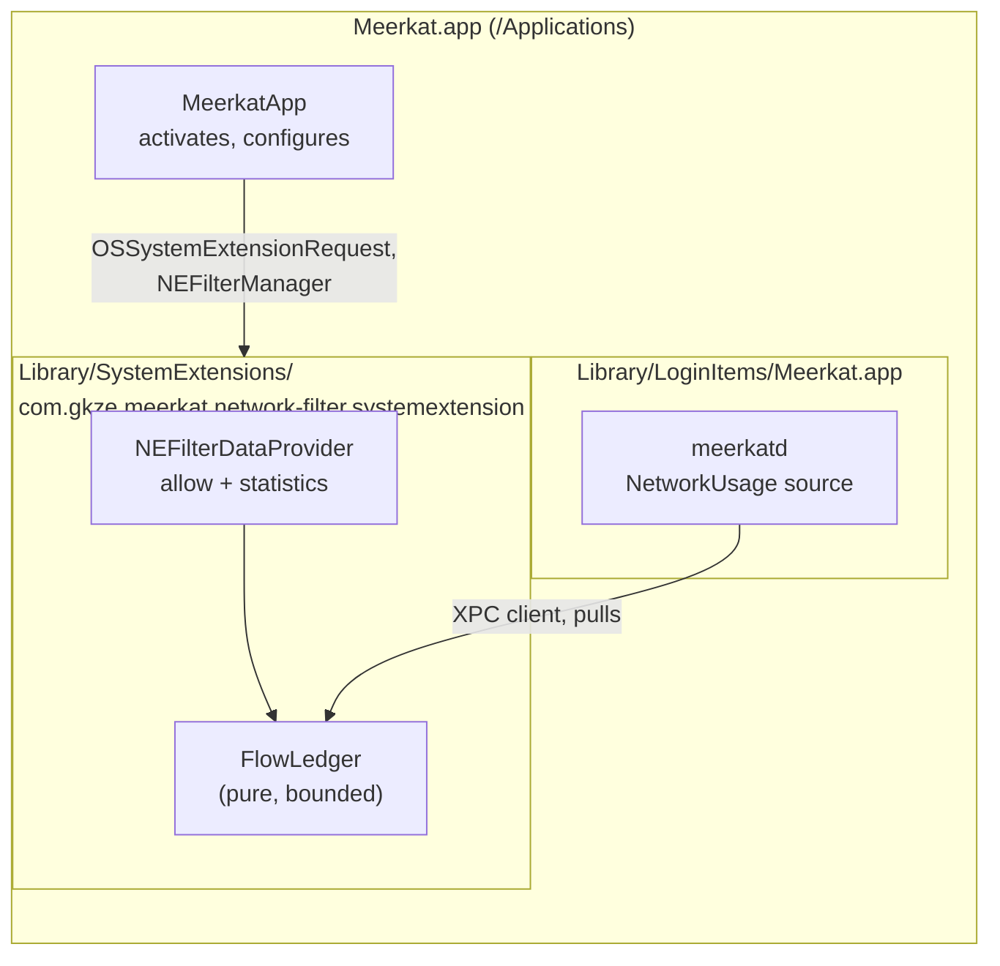

# Network filter: which process the traffic belongs to

Status: built 2026-11-11 (MeerkatNetworkFilter, MeerkatNetworkFilterExtension,
the process events, `network.flows`, the bundler, Settings › Network). Not
yet run signed on a Mac: the end-to-end checks below wait on the profiles. It amends acceptance criterion 2 and
the "Not included" list in [meerkatd.md](meerkatd.md), which ruled this out.

Contents: [Question](#question) · [Sources compared](#sources-compared) ·
[Shape](#shape) · [The extension](#the-extension) ·
[Extension to daemon](#extension-to-daemon) · [Events](#events) ·
[Activation](#activation) · [Harm model](#harm-model) ·
[Failure](#failure) · [Integrity tests](#integrity-tests) ·
[Prerequisites](#prerequisites) · [Decisions](#decisions)

## Question

`network.sample` reports bytes per interface and cannot say which process
moved them, so a rule that sees a network spike can only say so. Which
process (and, for traffic macOS sends on an app's behalf, which app) moved
how many bytes, for every process on the Mac, without Meerkat starting a
subprocess?

## Sources compared

Measured on this Mac (macOS 27, an unprivileged, unentitled process) on
2026-11-11, or read from the SDK headers:

| Source | Coverage | Detail | Verdict |
|---|---|---|---|
| NetworkExtension content filter (`NEFilterDataProvider`) | every process, all users | per flow: bytes in and out, `sourceAppAuditToken` (the app behind delegated traffic) and `sourceProcessAuditToken`, remote endpoint and hostname | chosen: public API, the only complete one |
| `com.apple.network.statistics` kernel control | the caller's user only | per socket: bytes, packets, interface, endpoints, pid and name | connects unprivileged, but sees no root or system-user daemons, and its message layouts are private and change by release |
| `net.inet.{tcp,udp}.pcblist_n` | none | — | the size query answers; a fetch returns 48 bytes (header and trailer, no sockets). `netstat` prints nothing |
| `libproc` `PROC_PIDFDSOCKETINFO` | own processes | socket state and buffer fill, no byte totals | no rates |
| Network.framework transfer reports | own connections | — | not other processes |
| NetworkStatistics.framework | as the kernel control | — | needs `com.apple.private.network.statistics`, which only Apple's binaries may hold |
| `/usr/bin/nettop` | every process | per process | holds that entitlement, but means a subprocess and parsing an undocumented format |

## Shape

The extension decides nothing about traffic. It allows every flow as it opens
and asks macOS for that flow's statistics, which macOS then reports to the
extension's own `handleReport(_:)`. It keeps a bounded table of bytes per
process and hands it to meerkatd when asked. meerkatd owns everything a rule
sees.

## The extension

- **One provider, data only.** `filterSockets = true`, `filterPackets = false`,
  no control provider, no browser filtering. Statistics and close reports come
  to the data provider itself (`NEFilterVerdict.shouldReport`).
- **Every new flow gets `allowVerdict()` at once**, with
  `statisticsReportFrequency = .low` (about every 5 s, the default sample
  interval) and `shouldReport = true`. Any reporting keeps the flow attached
  to the filter, and when the filter's session ends (the extension crashing)
  the kernel resets every attached connection: seen on macOS 27, a download
  reset the moment NetworkExtension uninstalled the session after the
  extension was killed, with running totals and with only the close
  reported alike. A filter that counts nothing has nothing to count, so the
  totals stay at 5 s and `CrashGuard` keeps a crashing extension from
  resetting connections again and again: after 3 crashes within 10 minutes it
  does not start, and so holds no connection, until the window passes.
  It never returns `filterDataVerdict`,
  `pauseVerdict`, `needRules` or `drop`, and never reads a byte of payload.
  `handleNewFlow` does no I/O and cannot throw. It records the flow's open
  there, because NetworkExtension reports no open for a flow allowed at once:
  on macOS 27 the provider gets statistics and closes, never a new-flow
  report (seen on the first signed run: 652 statistics, 699 closes, 0 opens).
  The open goes on a short queue of its own, a constant-time append that
  never takes the ledger's lock; the ledger drains it before every report
  and every read, and a full queue drops the open, counted.
- **`FlowLedger` is the whole state** (MeerkatNetworkFilter), a value type
  with no I/O: open flows keyed by the report's flow identifier, and running
  totals per process keyed by `(pid, pidversion)` from the audit token, so a
  reused pid is a new process. It counts only flows it saw open: a report
  for a flow it does not know (opened before the extension started, or
  evicted since) is counted as untracked and ignored, because charging it
  from zero would count the flow's history again. It drops a flow whose
  totals go down or whose process changes (not traffic). Each table holds at
  most a fixed number of entries; a full one loses its least recently
  reported eighth, counted. Under pressure totals come out low, visibly,
  never high.
- **Attribution:** `sourceAppAuditToken` names the process charged, which
  for traffic macOS sends on an app's behalf (a background download through
  nsurlsessiond) is that app.
- Sandboxed, as NetworkExtension system extensions must be, with only the
  network-extension entitlement and the app group its Mach service is named
  under.

## Extension to daemon

The extension runs as root in the system domain; meerkatd is a per-user
LaunchAgent. A root process cannot reliably reach a user's Mach service, but
any process can reach a system one. So the extension listens, on the Mach
service its Info.plist names (`NEMachServiceName`, under the team's app
group), and meerkatd connects as a client.

- **Both sides check the other's code signature**, not only the team:
  the extension accepts only a peer whose designated requirement names
  `com.gkze.meerkat.daemon` and the team; meerkatd accepts only an extension
  signed as `com.gkze.meerkat.network-filter` by the team. `.isFromSameTeam()`
  alone would let the CLI or any other team binary read every user's traffic
  totals.
- **One request, pull only:** the extension replies with its running totals
  per process, and per process and remote host while a rule observes
  `network.flows`, under an instance identifier that changes when it
  restarts. Each meerkatd (one per logged-in user) subtracts its last
  snapshot (`UsageDiffer`), so reads change nothing and readers never take
  each other's counts; a new instance is a new baseline, never a negative
  rate. The extension never pushes, so a slow or absent daemon costs it
  nothing, and nothing the daemon sends can change a verdict.
- The reply is a fixed, versioned `Codable` message decoded once at the
  daemon's boundary with bounds on every count and string; anything out of
  bounds fails the poll and is reported, never trapped on.

## Events

- **`ProcessUsage` gains `networkInMB` and `networkOutMB`** over the window,
  and `process.hot` gains metrics `networkInMBps`, `networkOutMBps` and
  `networkMBps`. They are present whatever the process's user is: unlike disk
  and energy, the filter sees every process.
- `process.top` and `process.list` rows carry the network fields.
- **Needing the filter is checked where a source starts**, not as a TCC
  permission (it has none of a permission's asking or status): `process.hot`
  on a network metric and `network.flows` are refused with where to turn the
  filter on; elsewhere the network fields are absent without it. The
  descriptors say so in their summaries, which reach `meerkat events list`
  and the generated declarations. Ranking `process.top` by network is not
  built yet.
- **New kind `network.flows`, observed by name** (`observe: { allow:
  ["network.flows"] }`), like `window.focused`: per window, each process's
  bytes in and out per remote host. The host is the flow's `remoteHostname`
  where macOS knows it (the name the app connected to), otherwise the remote
  address; the port and protocol come with it. It needs `networkFilter`
  `.required`. The extension aggregates hosts only while a rule subscribes
  (meerkatd says so in its poll), so no host table exists when nobody asks.
- `network.sample` is unchanged: interfaces remain its job.

## Activation

Off until the user turns it on in Meerkat › Settings › Network:

1. The app submits `OSSystemExtensionRequest.activationRequest`. macOS asks
   the user to allow the extension in System Settings.
2. The app saves an `NEFilterManager` configuration naming the provider and
   enables it. macOS asks the user to allow the content filter.
3. Turning it off disables the configuration and submits a deactivation
   request, which removes the extension. While the filter runs, the app asks
   first: the connections it counts fail when its session ends (Failure).

Only the app can do this: macOS requires a foreground app in `/Applications`.
meerkatd reports the filter's state (absent, awaiting approval, running,
unreachable) in `meerkat status` and the app.

## Harm model

Extends [mcp.md](mcp.md) ("Harm model"):

- **The extension is the most privileged code Meerkat ships.** It sees every
  connection on the Mac, as root. It is kept to the decisions above (allow,
  count) so that no decision of its can block a connection or reveal one's
  contents. Its crashing can reset the connections in flight, once per
  crash (see "Failure"); `CrashGuard` bounds that to three times in ten
  minutes, after which it stays off until the window passes.
- **Totals go to the process events; destinations only to `network.flows`.**
  Which hosts a process talks to says what the user is doing, so it is a
  named observation, never added to `process.hot` or `process.top`. The
  extension keeps no host table unless meerkatd's poll says a rule observes
  `network.flows`, and drops it when none has asked for a minute (`HostLease`),
  so a `network.flows` source polls at least every 30 seconds whatever its
  interval, and reports once per interval. No payload byte is ever read.
- Other users' processes are visible, so the new fields are subject to
  `ObservationScope` as every process field is: a rule with
  `process.observe: "own"` sees only its user's processes, in `network.flows`
  too, though it is a named kind (`ObservationScope.view`).
- MCP: kinds that need `networkFilter` are denied by default, as kinds that
  need a TCC permission are.

## Failure

| Failure | Effect | Behaviour |
|---|---|---|
| Extension crashes or is killed | NetworkExtension uninstalls the filter session about 5 s later, and the kernel resets the connections attached to it, once; new connections work again within a second as the session restarts (seen on macOS 27) | totals restart from zero; meerkatd sees a new extension instance and skips one window instead of reporting a negative or doubled rate; after 3 crashes in 10 minutes the extension does not start (`CrashGuard`) |
| Extension replaced by a new build | none on traffic: the new extension filters at once | the new process can start before the old one releases the Mach service, so activating the listener fails (EPERM, macOS 27); it tries again with backoff (1 s, doubling to 30 s) until it serves, and meerkatd reads totals again on its next poll after its own 30 s backoff |
| meerkatd absent or slow | none on traffic | ledger stays bounded; the oldest totals are evicted and counted |
| Ledger full (flow flood) | none on traffic | least recently reported flows evicted; `evicted` counted and shown in status; a `network.flows` window counts the endpoints evicted during it in `omitted` |
| Malformed or out-of-range report | none on traffic | flow dropped, counted |
| Malformed reply at the daemon | the poll fails | source reports unavailable with the reason; no trap |
| Filter not approved | none | `networkFilter` permission reads denied; rules on network metrics refused with where to turn it on, and resumed once it answers (meerkatd asks every 10 s while one waits, `RuleEngine.awaitNetworkFilter`) |
| Filter turned off | the session ends with the connections still attached to it: they stall and fail (a download stopped at the click and failed two minutes later, macOS 27); new connections are unaffected | as not approved, once the deactivation completes: a running `network.flows` rule fails after five windows without an answer, and resumes when the filter is on again; the extension is removed at the next restart |
| macOS update changes NE behaviour | — | the end-to-end test below fails before release |

## Integrity tests

The extension cannot be debugged on a user's Mac, so every property above is a
test, at the cheapest layer that can falsify it:

**Pure (FlowLedger, verdict policy), in their own target, no NetworkExtension:**

- Verdict policy: every input to the new-flow decision, including malformed
  ones, yields allow with statistics and reporting; no path yields drop,
  pause, filter-data or need-rules. Exhaustive over the decision's inputs.
- Deltas: cumulative counts become per-window deltas; a flow reported twice
  in a window is counted once; a close report ends the flow and keeps its
  final delta; counts that go down drop the flow and are counted.
- Identity: the same pid with a different pidversion is a different process;
  totals never cross between them.
- Host table: exists only while requested, is bounded separately from the
  process table, is dropped when no longer requested, and never changes the
  per-process totals.
- Bounds: under a generated flood (millions of flows, random closes,
  reordering, duplicates), memory stays within the fixed table sizes, totals
  never go negative, and evictions are counted exactly.
- Subtraction: the first snapshot and the first from a restarted extension
  are baselines; a total that went down yields nothing for that key; two
  readers of the same totals each get the whole delta.
- Property tests over random report sequences against an unbounded
  reference: with room for everything the ledger equals the reference
  exactly; under pressure every table stays within its limit at every step
  and no process or endpoint is ever charged more than the reference.
- Mutation checks: counting unknown flows from zero, or disabling eviction,
  must fail the suite (both checked when the core was written).

**Boundary:**

- Reply codec: round trip; rejection of every out-of-bounds count, string
  length and entry count; fuzzed bytes never trap.
- Peer requirements: the requirement strings built for each side accept the
  intended identifier and reject the CLI's, the app's, an ad-hoc and another
  team's (checked against signed fixtures).
- `handleNewFlow` latency: under a concurrent XPC load, the verdict path stays
  below a fixed bound and takes no lock the XPC side holds.

**Bundle (extends the bundle tests):**

- The system extension is at `Contents/Library/SystemExtensions/`, its
  Info.plist names the provider class and Mach service, its entitlements are
  exactly the network-extension and app-group ones, it is sandboxed, signed
  inside-out and its profile matches its identifier and team.

**End to end, on a real Mac, before each release:**

- Activate and approve; generate known traffic from a known process (a
  download of a known size from a test helper) and see it attributed within
  one window, within a stated tolerance.
- Kill the extension mid-download: the download is reset once, new
  connections work within a second, and the daemon skips one window and
  recovers. Three kills within ten minutes: the extension declines to start
  until the window passes, then starts by itself.
- Kill meerkatd: traffic is unaffected; the extension's memory stays bounded.
- Deactivate: the extension and the filter configuration are gone and new
  connections are unaffected; connections open at the time fail.

## Prerequisites

Only George can do these, in the Apple Developer account:

- App IDs with the Network Extensions capability for `com.gkze.meerkat` and
  `com.gkze.meerkat.network-filter`, the System Extension capability for the
  app, and an app group for the Mach service.
- Developer ID provisioning profiles for both, which the bundler embeds. Their
  paths are this Mac's settings (`.buckconfig.local`), not the repository's.
- The app installed in `/Applications`. The README's `~/Applications` option
  works for everything except this.

## Decisions

Confirmed with George on 2026-11-11:

1. Moving the boundary in acceptance criterion 2 to include a system extension
   the user opts into; George creates the profiles and installs to
   `/Applications`.
2. Totals per process on process events; remote hosts, ports and protocol per
   process only through the named kind `network.flows`.
3. Network metrics on `process.hot` and `process.top` rather than a new kind
   for totals.
4. Off by default, turned on in Settings.
