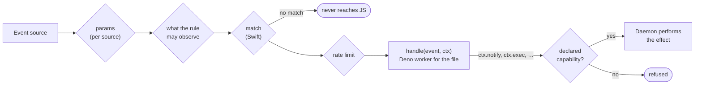

# Rules

Rules are TypeScript files in `~/.config/meerkat/rules` that `meerkatd`
runs against system events, with only the capabilities they declare.

A rule names an event, narrows it, declares what it may see and do, and
handles it, as the [Quick start](../README.md#quick-start)'s `downloads.ts` does.

More examples, all compiled by the test suite, are in
[Sources/meerkat-rules/examples](../Sources/meerkat-rules/examples/). Every event's payload, parameters and delivery
guarantees are listed by `meerkat events list` and in the generated
[Sources/meerkat-rules/meerkat.d.ts](../Sources/meerkat-rules/meerkat.d.ts).

## From event to effect

`params` configure the source and `match` filters payload fields. Both are
typed per event and evaluated in Swift, so events that do not match never
reach JavaScript. Each parameter's range and default are in its
documentation in `meerkat.d.ts`; a value outside the range is a load error
that names the field. Handlers react after the fact: nothing an unprivileged
process can observe lets it block the event.

## Files, exports and ids

- `rule()` returns the rule. A top-level file runs the rules it exports,
  either as exports of their own or in an exported array (nested arrays are
  flattened); other exports are ignored. The default export counts too, so
  a whole file can be `export default [rule({ ... }), rule({ ... })]`.
- Keep every rule in one file (`index.ts` can `export * from "./lib/audio"`)
  or spread them over many, each with any number of exports.
- A rule's id is `<file>#<name>`, where the file is the top-level file that
  exports it. A name holds no `#` and is at most 256 bytes; a rule whose name
  does not fit fails to load.
- A file that creates rules but exports none fails to load, and unexported
  rules are logged as warnings. `export * as audio` exports an object, not
  rules, so those rules do not run.

## Type checking, editors and linting

- Saving a file reloads the rules in well under a second. The daemon
  type-checks the whole directory with tsrs, the Rust port of TypeScript 7's
  compiler. A file
  with a type error is not run; every other file keeps running.
- The daemon writes `.meerkat/meerkat.d.ts`, `.meerkat/deno.d.ts` (the
  runtime's globals) and a `tsconfig.json` into the rules directory. Editors
  then check rules against the running daemon's catalog and runtime, with the
  daemon's compiler options; `tsrs --lsp --stdio` is the matching language
  server. `meerkat rules check [dir]` does the same from the command line.
- Rules are linted and format-checked with this repository's policy, by tools
  Meerkat.app ships, so no Node or Bun is needed: Oxlint with type-aware rules
  on tsrslint, meerkat-lint for the `meerkat/*` rules, and Oxfmt.
- The daemon writes `.meerkat/oxlintrc.json` (the policy, kept current) and,
  when they are absent, `.oxlintrc.json` and `.oxfmtrc.json`, which are yours
  after that. Editors with the Oxc extension pick them up.
- Each reload lints in the background. `meerkat rules` lists the findings,
  which are advice and never stop a rule from loading.
  `meerkat rules lint [--fix] [dir]` lints or fixes
  and formats; `meerkat rules fmt [--check] [dir]` formats.
- `meerkat rules dry-run <file> [--sample seconds | --payload json]` runs a
  rule from a file on events with its effects captured: nothing is sent,
  written or run, and the report shows what the handler asked for.

## Isolation and limits

- Handlers run in Deno, embedded in the daemon. Each file runs in a worker of
  its own (its own thread, V8 isolate, heap limit and Deno permissions), and
  each invocation has a deadline.
- A handler stuck in a loop is interrupted and the host restarts. So is a
  file whose timers keep its thread busy, or whose code runs out of heap. A
  file whose top-level code hangs is rejected on its own. Editing one file
  leaves the other files' rules running.
- A rule that keeps failing, or runs more than 120 times a minute, is
  disabled until its file changes. A rule whose handler holds the thread
  past its deadline, ending the host, three times within five minutes is
  disabled the same way. When the file's own code ends it (a timer, or
  running out of the heap all its rules share), the file is left out until
  it changes.
- Whatever a rule's file grants say, its code cannot change the rules
  folder, `meerkat.json` (where its symlink leads, too), the daemon's state
  or the app: not through a symlink, a hard link, or by renaming a folder or
  link above them. Nor can it read the daemon's state. The APIs that write or
  watch files around those checks are off: `node:fs`'s `cp` (it clones whole
  trees), Deno KV, `node:sqlite` databases, `node:wasi`, Unix socket
  listeners and file watching (`Deno.watchFs`, `fs.watch`; use the
  `fs.change` event). So are Web Locks, which every file would share.
- The heap limit does not cover memory outside the JavaScript heap, such as
  `ArrayBuffer` contents, and a handler may use the CPU for its whole
  timeout each time it runs.

## Capabilities

A rule sees only what it declares, as it acts only through what it declares.
Rules run inside the daemon as you, so macOS's file permissions narrow
nothing: the rule's grants are the boundary.

Observing an event can need a grant. `meerkat events list` says which, and
the types make `capabilities` required where one is; a rule without it does
not load, and the message names the grant to add:

| Events | Grant |
| --- | --- |
| Ambient state about this Mac: memory, CPU, power, displays, volumes, devices, the network's state, time, … | none |
| `fs.change`, `fs.churn` | `fs: { read: [...] }` covering every watched path; nothing at, inside or above the daemon's state folder |
| `process.*`, `app.*` | `process: { observe: "own" }` for your own processes, `"all"` for every user's |
| `window.focused`, `input.activity`, `pasteboard.changed`, `camera.inUse`, `audio.inUse`, `network.wifi`, `bluetooth.devices`, `session.logins`, `log.entry`, `darwin.notification`, `distributed.notification`, `iokit.*`, `power.assertions` | `observe: { allow: ["window.focused", ...] }`, naming each |

With `"own"`, events about other users' processes never reach the rule, and
their rows are left out of `process.top` and `process.list`. `fs.churn` without a `root`
measures `meerkat.json`'s `files` scope: if an edit moves it outside the
grant, the rule fails and says why, and resumes when it fits again. A
`meerkat.rule` status, a `meerkat.dropped` report and a `meerkat.notification`
response reach a rule only when they are about its own file.

Effects go through capabilities the rule declares and the daemon enforces.
They work only while the rule's handler is running.

Grants cover notifications, your own processes (targeted by pid plus start
time), allow-listed executables with no shell, requests to allow-listed
origins, the sample store, file reads and writes, keeping the Mac awake, audio,
applications, URLs, volumes, the Trash and Finder tags, user defaults,
Shortcuts, Wi-Fi power, the clipboard, windows and the appearance.
`meerkat effects` lists every effect and its grant, and
[docs/design/effects.md](design/effects.md) explains them.

`ctx.state` (persistent JSON: at most 1024 keys and 8 MiB per rule, 1 MiB per
value; null is a value, which `set` stores) and `ctx.log` are always available.

A click on a notification, one of its actions, or closing it arrives as a
`meerkat.notification` event. Only rules in the file whose rule posted the
notification receive it; the app, the CLI and MCP cannot subscribe to it.
[Sources/meerkat-rules/examples/heavy-writers.ts](../Sources/meerkat-rules/examples/heavy-writers.ts)
uses this for an "undo" button.

## Events that need a permission

A few events need a privacy permission:

| Event                                  | Permission       |
| -------------------------------------- | ---------------- |
| `window.focused`                       | Accessibility    |
| `input.activity`                       | Input Monitoring |
| `bluetooth.devices`                    | Bluetooth        |
| `network.wifi` (the network name only) | Location         |

Each also needs its observation grant: the permission is the daemon's, the
grant is the rule's. Nothing is requested until a rule subscribes to one of
these. `network.wifi` runs without Location and leaves the network name out;
the others fail and name the Settings pane where Meerkat can be enabled.
After granting it, run `meerkat rules reload`. The grant belongs to
the signed app bundle, so it survives rebuilds signed by the same team.
`meerkat events list` marks these events.

Some effects need a macOS permission too. `windows.list` and `windows.set`
need Accessibility, `meerkat effects` marks them, and they fail with the
Settings pane to use. macOS may ask before the first `clipboard.read`.
`appearance.setDark` needs Automation for System Events, which only the app
can ask for: use the Automation section of Meerkat's Settings.
